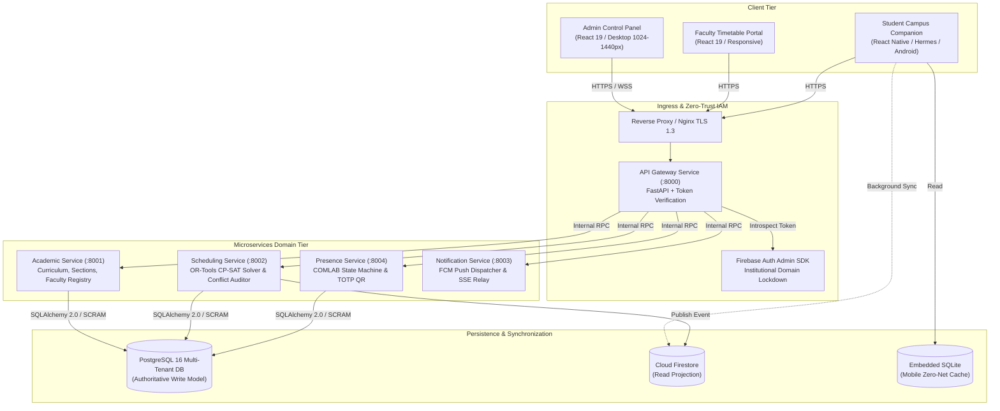
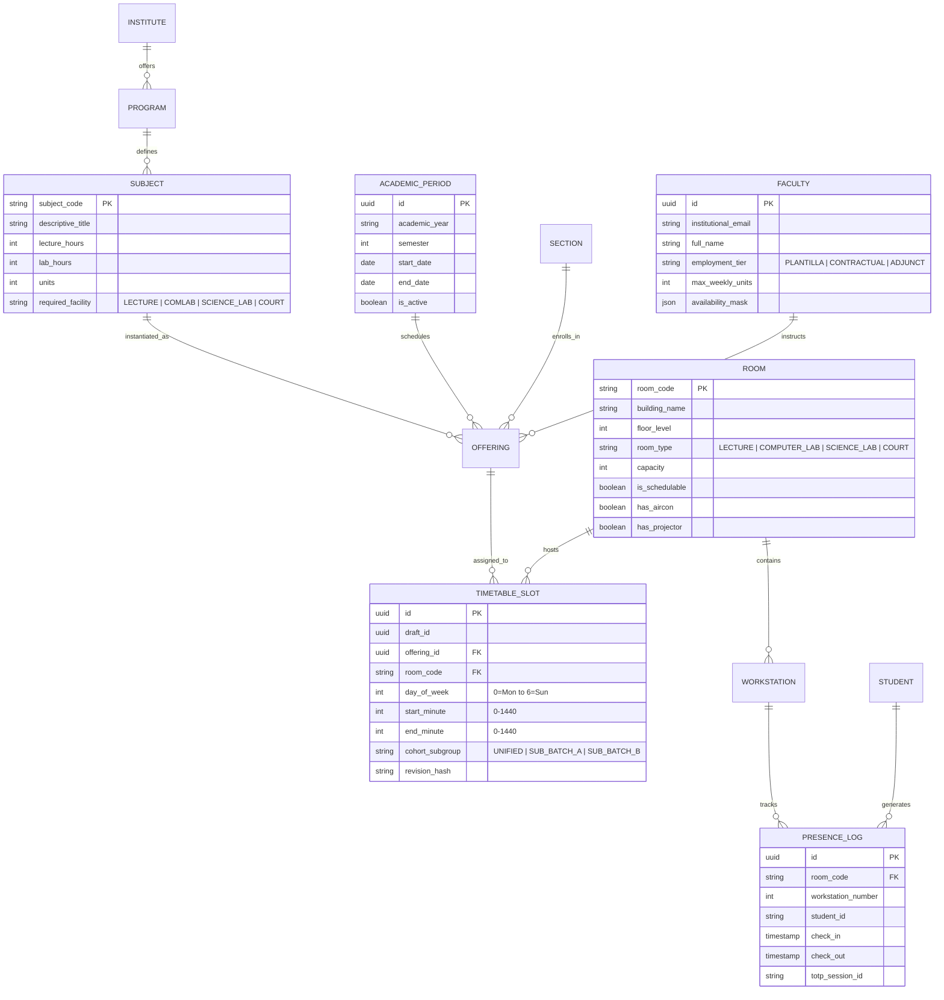
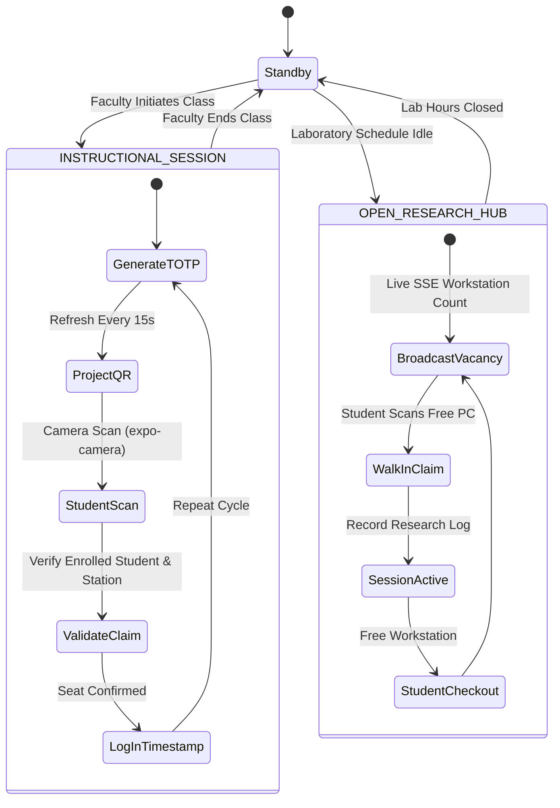

# System Design Document: ClassSync V2
**AI-Powered University Classroom Scheduling, Availability Monitoring, and Conflict Detection System**

---

## 1. System Overview & Architectural Goals

ClassSync V2 is an enterprise academic operations platform engineered to resolve physical room scarcity, cross-building transit bottlenecks, faculty overload, and laboratory attendance tracking in higher education institutions (specifically tailored for Colegio de Montalban / Pamantasan ng Montalban).

### Core Architectural Goals
1. **Mathematical Optimality & Zero Conflicts:** 100% elimination of room double-bookings and faculty schedule collisions using constraint programming.
2. **Dual-Tier CQRS Separation:** Isolate heavy relational scheduling and administrative writes from high-throughput mobile student reads.
3. **Offline-First Campus Resilience:** Guarantee instant timetable access on student mobile devices even in concrete campus cellular dead-zones.
4. **Physical Laboratory Telemetry:** Bridge digital schedules with physical workstation presence using dynamic rotating TOTP QR codes.
5. **Zero-Trust Institutional Security:** Restrict access strictly to validated institutional identities (`@student.pnm.edu.ph`, `@cdm.edu.ph`, `@pnm.edu.ph`).

---

## 2. System Architecture & Component Decomposition

ClassSync V2 implements a **Command Query Responsibility Segregation (CQRS)** pattern across containerized microservices:

---

## 3. Domain Model & Relational Schema (PostgreSQL 16)

---

## 4. Constraint Satisfaction Engine (Google OR-Tools CP-SAT)

The scheduling engine treats timetable generation as an exact constraint satisfaction optimization problem:

### Decision Variables
$$\text{Start}_{o} \in [0, T_{\text{max}}], \quad \text{Room}_{o, r} \in \{0, 1\}, \quad \text{Faculty}_{o, f} \in \{0, 1\}$$
For each course offering $o$, room $r$, and faculty $f$.

### Hard Constraints (Non-Negotiable)
1. **Facility Collision Prevention:**
   $$\sum_{o} \text{Interval}(o, r) \le 1 \quad \forall r \in \text{Rooms}, \forall t \in \text{Time}$$
2. **Faculty Overlap Prohibition:**
   $$\sum_{o} \text{Interval}(o, f) \le 1 \quad \forall f \in \text{Faculty}, \forall t \in \text{Time}$$
3. **Capacity Invariance:**
   $$\text{Capacity}(r) \ge \text{Enrollment}(o) \cdot \text{Room}_{o, r}$$
4. **Facility Type Matching:** A course requiring `COMPUTER_LAB` cannot be assigned to standard `LECTURE` halls.
5. **Specialized Space Restrictions:** Room `PRRC 108` is restricted exclusively to BSEd Science curriculum.
6. **ROTC Sunday Quarantine:** ROTC drills are locked to Sundays (`day = 6`) on the Athletic Oval and Covered Court.

### Institutional Campus Soft Constraints (Weighted Objectives)
1. **Inter-Building Transit Buffer (10 Minutes):**
   If consecutive offerings $o_1$ and $o_2$ for the same section or faculty transition between `PRRC Building` and `New Building`:
   $$\text{Start}_{o_2} - \text{End}_{o_1} \ge 10 \text{ minutes}$$
2. **Dynamic Staggered Lunch Break (60 Minutes):**
   Every section and faculty member must have an uninterrupted 60-minute window between 11:00 AM and 2:00 PM:
   $$\text{HasLunchBreak}(s, [660, 840]) = 1$$
3. **Split-Batch Cohort Division:**
   Sections with $\ge 50$ students retain unified 3-hour lecture blocks, but automatically divide into Sub-Batch A and Sub-Batch B (25–30 students each) for 45-workstation computer lab sessions.
4. **Faculty Subject Preparation Guard:**
   Penalize assigning more than 3 unique course codes to any individual instructor.

### Sub-Second Localized Delta Solver
When an emergency room failure occurs (e.g., AC malfunction in `PRRC 201`), the localized delta solver freezes all unaffected variables and resolves only the affected section/room assignments in $<0.1\text{s}$.

---

## 5. COMLAB 45-Station Controller & Physical Presence

- **TOTP Cryptography:** QR codes rotate every 15 seconds using `pyotp` (RFC 6238) keyed to the specific laboratory controller instance.
- **Fraud Elimination:** Screenshots and shared images expire before absent students can scan them remotely.
- **Seat Telemetry Broadcast:** Real-time seat availability is pushed to mobile clients via Server-Sent Events (`/api/v1/timetables/events/{tenant_id}`).

---

## 6. Zero-Trust Security & Identity Architecture

1. **Institutional Domain Enforcement:**
   - Student identities must belong to `@student.pnm.edu.ph`.
   - Faculty/Admin identities must belong to `@cdm.edu.ph` or `@pnm.edu.ph`.
2. **Custom Claims Token Introspection:**
   - Identity tokens contain cryptographically verified claims: `tenant_id`, `role`, `department_id`, and `student_id`/`faculty_id`.
   - Microservices independently inspect token claims; frontend client-side route guards are treated strictly as presentation ergonomics.
3. **OWASP ASVS 4.0 Level 2 Password Policy:**
   - High-entropy requirement with real-time feedback.
   - Blocks institutional dictionary patterns (`cdm2024`, `pnm123`, `classync`).
4. **Immutable Publication Hash-Chaining:**
   - Released schedules receive an immutable SHA-256 revision hash.
   - Any post-publication administrative modification creates an append-only audit trail logging user ID, timestamp, and justification.

---

## 7. UI/UX Design System & Ergonomics

### Breakpoint Strategy
- **Mobile First (Students, 360px – 412px):** Optimized for single-handed Android operation. Next class countdown hero card, immediate QR attendance scanner button, and bottom navigation bar.
- **Desktop First (Admin / Faculty, 1024px – 1440px+):** High-density weekly timetable matrices, split-pane conflict inspectors, and multi-filter room directories.

### Design Tokens
- **Primary:** Deep Sapphire `#0F2C59` (Institutional Authority)
- **Accent:** Crimson Gold `#DDA853` (Action & Highlights)
- **Surfaces:** Clean Canvas `#F8F9FA` / Elevated Cards `#FFFFFF`
- **Text:** High-Contrast Ink `#1E293B` / Subtext `#64748B`
- **Status Semantic:** Error `#EF4444`, Warning `#F59E0B`, Success `#10B981`
- **Typography Scale:** Inter / SF Pro Display; strictly adhering to 48dp minimum touch target sizes and WCAG 2.2 AA color contrast ratios ($\ge 4.5:1$).

---

## 8. Infrastructure & Production SLA

| Dimension | Target Specification |
|---|---|
| **Container Runtime** | Docker Engine 24.0+ & Docker Compose v2 |
| **Ingress Controller** | Nginx Reverse Proxy with TLS 1.3 & HTTP/2 |
| **Solver Computation Target** | Master Batch: $<120\text{s}$ \| Delta Re-Solve: $<0.1\text{s}$ |
| **Mobile Sync Latency** | Offline Read: $0\text{ms}$ \| Online Sync: $<1.5\text{s}$ |
| **Database Resiliency** | PostgreSQL 16 automated WAL archiving with hourly snapshots |
| **Service Health Probes** | Periodic Liveness & Readiness checks on `/health` across all pods |
