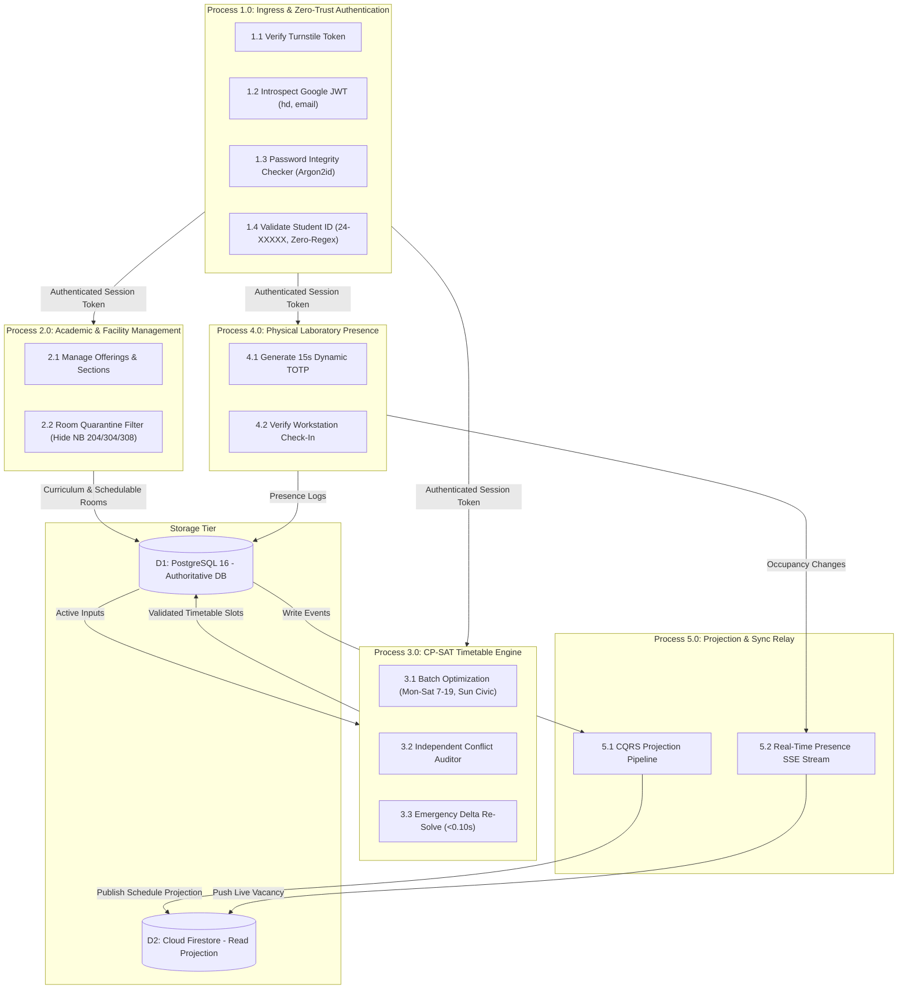
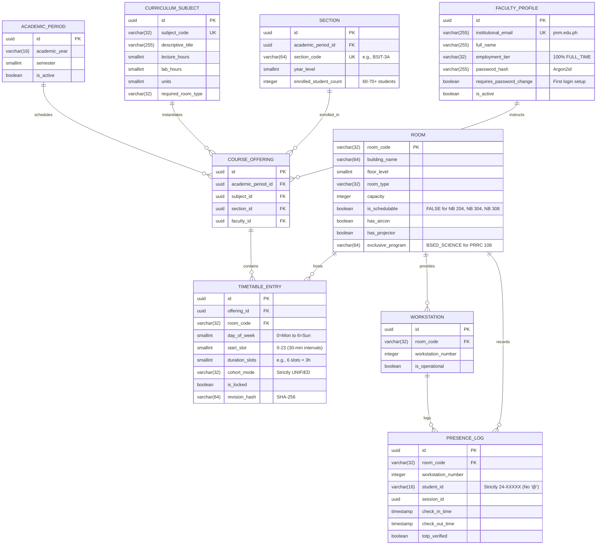

# ClassSync V2: Comprehensive System Design Blueprint & Integrated Capstone Technical Manuscript Specification

**Institution:** Colegio de Montalban / Pamantasan ng Montalban (CdM / PNM)  
**Institute:** Institute of Computing Studies  
**Project Title:** *ClassSync: AI-Powered University Classroom Scheduling, Availability Monitoring, and Conflict Detection System*  
**Academic Year:** 2026–2027  

---

## 1. Executive Summary & 6-Course Curriculum Alignment

This master technical document unifies the research, architecture, mathematical modeling, and production implementation of **ClassSync V2** across the six participating courses:

| Course & Faculty Lead | Core Project Focus | ClassSync Implementation & Evidence |
|---|---|---|
| **Information Assurance and Security**<br>*(Sir Mades)* | Zero-Trust Authentication, Turnstile Edge Mitigation, RBAC, Password Integrity | Cloudflare Turnstile token validation via edge proxy; Google Workspace OAuth cryptographically verified (`hd == "student.pnm.edu.ph"`, `email_verified == True`); Zero-regex student ID parsing (`24-XXXXX`); Mandatory first-time password setup with OWASP ASVS 4.0 entropy checker; Argon2id password hashing; database-level quarantine of non-schedulable spaces. |
| **Integrative Programming and Technologies 2**<br>*(Sir Nat)* | Microservices Architecture, FastAPI REST APIs, Google OR-Tools CP-SAT | Decoupled microservices (`gateway` :8000, `academic` :8001, `scheduling` :8002, `presence` :8004); CP-SAT constraint optimization engine (Mon–Sat 07:00–19:00, Sunday ROTC/NSTP in Function Hall); Sub-second ($<0.10\text{s}$) localized delta re-solver; Pydantic V2 shared schemas; interactive OpenAPI/Swagger at `/docs`. |
| **Advanced Database Management System**<br>*(Ma'am Gretchen)* | Dual-Tier Relational & Cloud Database Architecture | PostgreSQL 16 on Render (SCRAM-SHA-256, connection pooling, ACID constraints, Alembic migrations); Cloud Firestore (Firebase) high-throughput document projections for real-time mobile read synchronization and workstation presence state. |
| **Application Development**<br>*(Ma'am Gretchen)* | Progressive Web Application (PWA) & Mobile Client | React 19 + TypeScript + Vite + Tailwind CSS web client (Vercel); React Native (Expo) student companion app; hardware camera QR scanner (`expo-camera`); service worker offline caching; dynamic workstation claiming. |
| **Information Management**<br>*(Ma'am Lamadora)* | Information Requirements, Process Modeling, Manuscript | Context Level 0 & Level 1 Data Flow Diagrams (DFDs); Process flowcharts; Requirements Traceability Matrix; Formal academic manuscript (Chapters 1 to 6). |
| **Human-Computer Interaction (HCI)**<br>*(Ma'am Andrea)* | User-Centered Design, Accessibility, Technical Report | Soft Rouge & Cool Neutral design system (`--brand-midnight: #34141f`, `--brand-rouge: #872e49`); self-hosted `InterVariable.woff2`; WCAG 2.2 AA contrast compliance ($\ge 4.5:1$); touch targets $\ge 48\text{px}$; System Usability Scale (SUS) evaluation instrument; functional micro-interactions; zero-jargon communication. |

---

## 2. Institutional Constraints & Domain Rules

1. **Operating Windows & Granularity:**
   * **Academic Lectures & Laboratories:** Monday through Saturday, strictly 07:00 to 19:00. Time is discretized into continuous 30-minute standard intervals (Slots 0 to 23). Zero 10-minute inter-building penalties.
   * **Sunday Civic Training:**
     * **ROTC:** Strictly 07:00 – 12:00, utilizing the **Function Hall**.
     * **NSTP (CWTS / LTS):** Strictly 13:00 – 17:00, utilizing the **Function Hall**.
     * **PATHFIT / Sports:** Athletic Oval, Montalban Sports Complex, and Open Grounds.
2. **Faculty Composition & Scheduling Limits:**
   * 100% Full-Time Faculty (0 part-time, 0 adjunct).
   * Available by default across 07:00–19:00 Mon–Sat unless administrative blockout is applied.
   * Zero artificial fatigue caps (no 3-hour daily limits) and zero subject-prep limits.
3. **Cohort Sizing & Laboratory Workstations:**
   * Section sizes regularly exceed 60–70+ students.
   * **Zero Sub-Batch Splitting:** Sections are scheduled as unified cohorts for both lectures and computer lab sessions.
   * COMLAB workstation capacity scales dynamically to match enrolled section sizes.
4. **Physical Spaces & Quarantined Directory Views:**
   * **Schedulable:** Standard lecture halls, computer labs (PRRC Floor 3), PRRC 108 (locked to BSEd Science), Function Hall.
   * **Quarantined (Non-Schedulable):** Faculty offices (`NB 204`, `NB 304`), faculty lounge (`NB 308`), property/storage, and canteen areas are hidden from Student and Faculty directory views.
5. **Zero-Trust Security & Zero-Regex Parsing:**
   * Cloudflare Turnstile token verified server-side against `https://challenges.cloudflare.com/turnstile/v0/siteverify`.
   * Google Workspace OAuth token introspection: `token["email_verified"] is True`, `token.get("hd") in {"student.pnm.edu.ph", "pnm.edu.ph"}`.
   * Student ID format strictly `24-XXXXX` (len == 8, starts with '24-', digits only; rejects email characters `@`).
   * Password Integrity Checker: First login forces local password/passcode creation (Argon2id, OWASP ASVS 4.0, campus dictionary blacklist).

---

## 3. Data Flow Diagrams (DFDs)

### 3.1 DFD Level 0: Context Diagram
```mermaid
flowchart TD
    Student["Student Entity\n(PWA / Mobile)"]
    Faculty["Faculty Entity\n(Web Projector)"]
    Admin["Academic Administrator\n(Web Console)"]
    GoogleIdP["Google Workspace IdP\n(@student.pnm.edu.ph / @pnm.edu.ph)"]
    Turnstile["Cloudflare Turnstile Edge\n(Bot / Challenge Verification)"]

    System["ClassSync V2 Core Platform\n(Gateway, Academic, Scheduling, Presence)"]

    Student -->|Turnstile Token + Google Auth / Password| System
    Faculty -->|Turnstile Token + Google Auth / Password| System
    Admin -->|Turnstile Token + Google Auth / Password| System

    System -->|Siteverify API Call| Turnstile
    Turnstile -->|Challenge Success: true/false| System

    System -->|Token Claims Introspection| GoogleIdP
    GoogleIdP -->|Cryptographic Claims (hd, email_verified)| System

    Admin -->|Curriculum Offerings, Room Quarantine Flags| System
    Admin -->|Execute Solver & Emergency Delta Overrides| System
    System -->|Master Timetable Grid & Conflict Audit Logs| Admin

    Faculty -->|Initiate COMLAB Session & Request Room Swaps| System
    System -->|15s Rotating TOTP QR Stream & Teaching Schedule| Faculty

    Student -->|Student ID (24-XXXXX) & Workstation Check-In| System
    System -->|Personal Timetable, Next Class Locator & Vacancy| Student
```

### 3.2 DFD Level 1: Subsystem Process Decomposition


---

## 4. Database Architecture & Data Dictionary

### 4.1 Relational ERD (PostgreSQL 16)


---

## 5. Official CdM Manuscript Structure (Chapters 1–6)

The manuscript complies strictly with the official **Colegio de Montalban Institute of Computing Studies Technical Documentation Guidelines** (A4 size, Times New Roman 12 pt, 1.5 line spacing, 1.25" left margin, 1.0" top/right/bottom):

* **Title Page:** Prescribed cover page format.
* **Approval Sheet:** Signatures of 6 subject professors (Sir Mades, Sir Nat, Ma'am Gretchen, Ma'am Lamadora, Ma'am Andrea).
* **Acknowledgment & Abstract:** 150–250 words summarizing the problem, CP-SAT solver, TOTP attendance, and results.
* **Table of Contents, Lists of Figures/Tables/Appendices:** Complete pagination.
* **CHAPTER 1 – PROJECT OVERVIEW AND INTRODUCTION**
  * 1.1 Introduction
  * 1.2 Background of the Project (Classroom scarcity, manual conflict errors at CdM/PNM)
  * 1.3 Statement of the Problem (P1: Collisions, P2: Lab attendance fraud, P3: Sub-batch splitting issues)
  * 1.4 Project Objectives (General + Specific objectives across the 6 subjects)
  * 1.5 Scope and Limitations (Mon–Sat 07:00–19:00, Sunday ROTC/NSTP in Function Hall, PATHFIT on grounds, 100% full-time faculty)
  * 1.6 Significance of the Project (Benefits to administration, faculty, and students)
  * 1.7 Definition of Terms (CP-SAT, TOTP, Zero-Regex, CQRS, Turnstile, RBAC)
* **CHAPTER 2 – SYSTEM ANALYSIS AND REQUIREMENTS**
  * 2.1 Project Description
  * 2.2 Stakeholder and User Identification (Student, Faculty, Administrator)
  * 2.3 Functional Requirements (FR-01 to FR-15 with unique IDs)
  * 2.4 Non-Functional Requirements (NFR-01 to NFR-08: Security, Performance, Usability)
  * 2.5 Use Case Diagram & 2.6 Use Case Descriptions
  * 2.7 System Process Flowcharts (Auth, CP-SAT, Delta Solver, TOTP Presence)
  * 2.8 System Architecture (PWA, FastAPI, PostgreSQL, Firestore, Turnstile)
  * 2.9 Requirements Traceability Matrix (Mapping requirements to test cases)
* **CHAPTER 3 – SYSTEM DESIGN AND DEVELOPMENT**
  * 3.1 Development Methodology (Iterative / Agile Scrum)
  * 3.2 System Architecture Design
  * 3.3 Database Design (ERD, Schema, Data Dictionary, Cloud Firestore integration)
  * 3.4 UI/UX Design (User-centered, Wireframes, Navigation, Responsive, Accessibility WCAG 2.2 AA)
  * 3.5 Frontend Development (React 19, TypeScript, Tailwind, PWA manifest)
  * 3.6 Backend Development (FastAPI, CP-SAT, OpenAPI /docs, CRUD, Logging, Secrets)
  * 3.7 Information Security Implementation (Turnstile, Google OAuth, Argon2id, RBAC, Zero-Regex)
* **CHAPTER 4 – SYSTEM IMPLEMENTATION AND TESTING**
  * 4.1 Environment (Python 3.12, Node 22, PostgreSQL 16, Render, Vercel)
  * 4.2 Deployment & Configuration
  * 4.3 Frontend Functional Testing
  * 4.4 Backend & API Testing (Postman test suites)
  * 4.5 Database Testing (ACID integrity & Firestore sync)
  * 4.6 Security Testing (Zero-regex, unauthorized token rejection)
  * 4.7 Usability Testing (System Usability Scale - SUS)
  * 4.8 Performance Testing (Solver benchmarks $<120\text{s}$, delta re-solve $<0.10\text{s}$)
  * 4.9 Testing Summary & 4.10 Minimum Test Case Format (TC-API, TC-AUTH, TC-DB)
* **CHAPTER 5 – RESULTS AND DISCUSSION**
  * 5.1 Overview of Developed System
  * 5.2 System Functionalities (Screenshots with detailed explanations)
  * 5.3 Frontend/Backend Integration Results
  * 5.4 Database Persistence Results (PostgreSQL & Firestore Console verification)
  * 5.5 Information Security Results
  * 5.6 HCI Evaluation Results (SUS score analysis)
  * 5.7 Overall System Evaluation
* **CHAPTER 6 – CONCLUSION AND RECOMMENDATIONS**
  * 6.1 Conclusion (Evaluation against objectives)
  * 6.2 Recommendations (Future satellite campus expansion, IoT kiosk scanner)
* **REFERENCES (APA 7th Edition)**
* **APPENDICES A–I:** System Screenshots, API Documentation, Postman Evidence, Database Documentation, Security Evidence, HCI Evaluation Instrument, User Manual, Deployment Guide, Repository Structure.

---

## 6. Implementation Decision Log

| ID | Core Architectural Decision | Alternatives Considered | Rationale & Trade-off Evaluation |
|---|---|---|---|
| **D-01** | **Monorepo Workspace Layout:** Unified workspace managing `apps/web` (React 19 PWA), `apps/mobile` (React Native Expo), `packages/shared-types-ts`, `packages/contracts-py`, and `services/` (FastAPI microservices). | (a) Polyrepo (isolated repo per service)<br>(b) npm / Yarn workspaces<br>(c) Turborepo build system | Polyrepo introduces massive cross-repository synchronization overhead and divergent data contract versions across a 9-person student capstone team. pnpm monorepo provides strict dependency hoisting, minimal disk footprint via content-addressable storage, and unified type validation between Python backend schemas and TypeScript frontend types. |
| **D-02** | **Zero-Regex Security Architecture:** Deterministic length validation, ASCII character boundary checks, and exact string equality on Google claims (`email_verified == True`, `hd in {'student.pnm.edu.ph', 'pnm.edu.ph'}`). | (a) Standard ECMAScript Regular Expressions<br>(b) Formal Context-Free Grammar parser | Regex engines are prone to ReDoS (Regular Expression Denial of Service), parsing inconsistencies across engines (Python `re` vs V8 regex), and silent injection bypasses. Deterministic string bounds checking guarantees $O(n)$ deterministic execution, eliminates ReDoS vulnerabilities, and provides an auditable verification trail for the IAS course deliverable. |
| **D-03** | **CP-SAT Timetable Constraint Formulation:** Exact constraint programming via Google OR-Tools CP-SAT using continuous 30-minute intervals (Slots 0–23, Mon–Sat 07:00–19:00), strictly unified cohorts (no $A/B$ batch split), and Sunday civic space locking. | (a) Genetic Algorithms (GA)<br>(b) Simulated Annealing / Tabu Search<br>(c) Mixed Integer Linear Programming (MILP) | Heuristic methods (GA, Annealing) only approximate solutions and frequently get trapped in local optima with lingering hard collisions. CP-SAT applies SAT-based clause learning and branch-and-bound pruning to mathematically guarantee 100% hard constraint satisfiability and provably zero schedule collisions. |
| **D-04** | **Hardware & Physical Presence Telemetry:** RFC 6238 TOTP with a rolling 15-second time window projected dynamically in comlabs; students submit `{room_code, workstation_number, totp_token}` via mobile camera scanner. | (a) Static wall-mounted QR codes<br>(b) Geofencing / GPS tracking<br>(c) RFID / NFC physical badges | Static QR codes enable trivial proxy attendance fraud (photographing and texting QR to absent students). GPS suffers severe multipath degradation inside concrete academic buildings. RFC 6238 TOTP rolling every 15s ensures scan validity expires before a proxy image can be relayed remotely, requiring zero specialized scanning hardware beyond the teacher's projector and student smartphones. |
| **D-05** | **Spatial Quarantine Filter:** Database-level predicate (`WHERE is_schedulable = TRUE`) hiding administrative offices (`NB 204`, `NB 304`), faculty lounge (`NB 308`), storage facilities, and canteen from public directory views. | (a) Frontend route-level filtering<br>(b) Hardcoded client exclusion arrays | Client-side filtering is inherently vulnerable to tampering via DevTools inspection or direct API query. Database-level quarantine guarantees non-schedulable physical assets are physically absent from serialized API payloads, eliminating accidental faculty office room bookings at the data layer. |
| **D-06** | **Sunday Civic Activity Allocation:** Partitioning the Function Hall into ROTC morning shift (07:00–12:00) and NSTP afternoon shift (13:00–17:00); reserving Athletic Oval and Montalban Sports Complex exclusively for PATHFIT. | (a) Mixed weekday scheduling<br>(b) Off-campus outsourced facilities | Scheduling large civic training cohorts during academic weekdays induces severe corridor crowding and acoustic interference with lectures. Rigid spatial-temporal partitioning prevents civic-academic collisions while maximizing weekend civic utilization of large assembly areas. |
| **D-07** | **Hybrid Authentication & Password Integrity:** Mandatory first login Google Workspace OAuth domain verification prompting local password creation enforced by OWASP ASVS 4.0 entropy checker; subsequent sign-ins support student ID + password or Google SSO. | (a) Google SSO only<br>(b) Plain Username/Password without institutional identity link | Pure SSO fails when institutional Google Workspace accounts experience administrative suspension or network egress outages. Pure password auth lacks proof of institutional student enrollment. Hybrid model binds student status cryptographically upon first setup while enabling resilient local authentication backed by Argon2id hashing. |
| **D-08** | **Hosting & Domain Architecture:** Static PWA web client hosted on Vercel with CDN edge caching; backend microservices containerized on Render; Cloud Firestore for real-time mobile read projections. | (a) Self-hosted on-premise physical campus server<br>(b) Single monolithic VPS (DigitalOcean / Linode) | Campus on-premise hardware suffers from power grid instability and campus network downtime during inclement weather. Decoupled cloud hosting ensures the student timetable read surface remains 100% available with zero institutional infrastructure maintenance overhead. |
| **D-09** | **HCI & Cognitive Load Optimization (Laws of UX):** Mobile layout anchors primary actions in the thumb zone (Fitts's Law $\ge 48\text{px}$); home screen hero card answers the immediate student question *"Where is my next class right now?"* (Hick's Law); standard bottom tabs (Jakob's Law); 3-item chunking (Miller's Law); sub-400ms feedback (Doherty Threshold). | (a) Dense desktop-style tabular grid on mobile<br>(b) Multi-level accordion schedule tree | Tabular grids on mobile devices require horizontal panning and high visual hunting effort, inducing cognitive fatigue. Hero card ergonomics satisfy the critical path query in $<1$ glance, complying with HCI WCAG 2.2 AA usability mandates. |
| **D-10** | **Functional Micro-Interaction & Motion Standards:** Micro-interactions restricted to tactile feedback (active scale `0.97`, verification pop, seat claim pulse, 15s radial ring) bounded at $\le 250\text{ms}$; complete suppression under `prefers-reduced-motion`. | (a) Elaborate 3D CSS transition effects<br>(b) Completely static interface with zero feedback | Gratuitous animation increases battery consumption on budget student Android devices and causes vestibular disorientation. Tactile physics-based micro-interactions communicate system state clearly while respecting accessibility preferences. |
| **D-11** | **Skeleton Screen Loading Strategy:** Replacing blocking full-screen modal spinners with structural CSS pulse placeholders (`animate-pulse`) mirroring exact card layouts. | (a) Blocking overlay activity spinners<br>(b) Blank white page during async fetch | Spinners convey an indeterminate wait time and cause severe Cumulative Layout Shift (CLS) when content abruptly renders. Layout-matched skeleton placeholders maintain structural stability, reduce perceived wait time below the 400ms Doherty threshold, and provide immediate visual context. |
| **D-12** | **Plain-Language Human-Centered Error Communication:** Absolute ban on internal system jargon (`409 Conflict`, `CP-SAT Infeasibility`, `TOTP Desync`, `Regex violation`); direct empathetic explanations with immediate actionable alternatives. | (a) Raw HTTP error codes and stack traces<br>(b) Generic "An error occurred" toast alerts | Exposing low-level exception strings confuses students and faculty, increases support desk burden, and exposes internal implementation details. Plain-language mapping guides users directly to recovery (e.g., suggesting the adjacent workstation PC-15 when PC-14 was just claimed). |
| **D-13** | **Cloudflare Turnstile Bot Verification:** Real Cloudflare Turnstile widget (`@marsidev/react-turnstile`) replaces the simulated CAPTCHA timer. Client obtains a verification token; gateway validates it server-side via `challenges.cloudflare.com/turnstile/v0/siteverify`. Submit button is disabled until Turnstile passes. CSP allows `challenges.cloudflare.com` for `script-src`, `connect-src`, and `frame-src`. | (a) reCAPTCHA v2/v3 (Google telemetry, heavier bundle)<br>(b) hCaptcha (revenue-share model adds friction)<br>(c) No CAPTCHA (exposes login to credential-stuffing bots) | Turnstile is invisible-first with a managed challenge fallback, requires no user interaction in the happy path, has zero Google tracking, and Cloudflare's free tier covers institutional traffic. Server-side verification prevents client-side token forgery. Test keys (`1x00000000000000000000AA` / `1x0000000000000000000000000000000AA`) allow full local development without a Cloudflare account. |

---

## 7. UI/UX Architecture, Wireframes & Human-Centered Communication

### 7.1 The 6 Laws of UX in ClassSync
1. **Fitts's Law:** On mobile, primary "Scan Seat QR" action is anchored in the natural thumb zone with $\ge 48\text{px}$ touch targets.
2. **Hick's Law:** Home screen hero card immediately satisfies the student's #1 question (*"Where is my next class right now?"*) without navigating nested menus.
3. **Jakob's Law:** Standard 2-column desktop auth layout (form on left, campus visual on right matching the official CdM reference) and standard PWA bottom tabs.
4. **Miller's Law:** Information chunked by Day (Mon–Sat) and pills limited to 3 items: `[Code]`, `[Room]`, and `[Time]`.
5. **Doherty Threshold & Skeleton Loading:** Sub-400ms perceived speed; skeleton loaders pre-occupy exact card dimensions.
6. **Nielsen Heuristic #1 & #2:** Visibility of system status (15s radial timer, live seat count) and plain-language copy without system jargon.

### 7.2 Human-Centered Plain Language Translation Matrix

| Technical Event / Backend Code | ❌ Technical Jargon (Banned) | ✅ ClassSync User-Centered Copy |
|---|---|---|
| `HTTP 409: Workstation Conflict` | *"Unique constraint violation on PC-14."* | *"Seat PC-14 was just claimed by a classmate! PC-15 is open right next to it."* |
| `RFC 6238 TOTP Expired (>15s)` | *"Token validation timestamp failure."* | *"The QR code just refreshed! Point your camera at the screen to scan the new code."* |
| `Google OAuth hd claim mismatch` | *"Claim mismatch: Invalid hosted domain."* | *"Please select your official school Google account (@student.pnm.edu.ph) to sign in."* |
| `Offline Cellular Dead-Zone` | *"SocketException: Connection refused."* | *"🟢 Offline Mode • Showing your saved schedule. Reconnecting to campus Wi-Fi..."* |
| `Emergency Room Delta Re-solve` | *"Executing heuristic delta reallocation."* | *"⚠️ Room Update: Your class moved to PRRC 302 due to AC maintenance."* |
| `Zero-Regex Student ID Format` | *"Regex constraint violation on suffix."* | *"Student IDs must look like 24-00123 (numbers only, no emails)."* |

---

## 8. Implementation Traceability & Validation Checklist (Phases 1–6)

Use this checklist during implementation to verify that every verified constraint and design principle is present in code:

### Phase 1: Contracts & Database Schemas
- [ ] Monorepo workspace initialized (`apps/web`, `packages/shared-types-ts`, `packages/contracts-py`, `services/`).
- [ ] PostgreSQL 16 SQLAlchemy 2.0 models authored (`AcademicPeriod`, `Room`, `CurriculumSubject`, `FacultyProfile`, `Section`, `CourseOffering`, `TimetableEntry`, `Workstation`, `PresenceLog`).
- [ ] Quarantined rooms flagged `is_schedulable = FALSE` (`NB 204`, `NB 304`, `NB 308`, storage, canteen).
- [ ] PRRC 108 locked to `BSED_SCIENCE`.
- [ ] Alembic migration generated and verified against local PostgreSQL.

### Phase 2: Solver Calibration (OR-Tools CP-SAT)
- [ ] Mon–Sat 07:00–19:00 horizon enforced (continuous 30-min slots 0–23).
- [ ] Sunday Function Hall partitioned into ROTC (07:00–12:00) and NSTP (13:00–17:00).
- [ ] Athletic Oval & Grounds dedicated to PATHFIT.
- [ ] Sections of 60–70+ students scheduled as unified cohorts (zero sub-batch splitting).
- [ ] Dynamic COMLAB workstation scaling matches enrolled section size.
- [ ] Independent secondary conflict validator confirms 0% room and faculty collisions.
- [ ] Sub-second ($<0.10\text{s}$) localized delta re-solver implemented.

### Phase 3: Hardware & COMLAB Presence
- [ ] 15-second dynamic TOTP QR code generator implemented using `pyotp`.
- [ ] Projector view renders SVG radial countdown ring and live occupied counter.
- [ ] Mobile camera scanner checks in workstation with sub-second verification.
- [ ] SSE real-time vacancy stream (`text/event-stream`) broadcasts to Cloud Firestore.

### Phase 4: Security Gateway
- [ ] Cloudflare Turnstile token verified server-side against `siteverify`.
- [ ] Google Workspace OAuth JWT verified via Google Admin SDK.
- [ ] Exact Hosted Domain check: `hd == "student.pnm.edu.ph"` (Student), `hd == "pnm.edu.ph"` (Faculty/Admin).
- [ ] Deprecated `@cdm.edu.ph` and personal `@gmail.com` rejected with user-friendly copy.
- [ ] Student ID parsed with zero regex (`len == 8`, starts with `'24-'`, numeric digits only).
- [ ] Password Integrity Checker enforces OWASP ASVS 4.0 and campus dictionary blacklist.

### Phase 5: Client Applications (React 19 PWA & Mobile)
- [ ] Self-hosted `InterVariable.woff2` and CdM/ClassSync branding assets bundled.
- [ ] CdM split-screen welcome page rendered with Turnstile and Google SSO.
- [ ] Student Portal: "Next Class Hero Card", day-chunked timetables, live COMLAB vacancies.
- [ ] Faculty Portal: Teaching schedule, room swap request, and full-screen projector QR mode.
- [ ] Admin Portal: Room directory filtering quarantined spaces, CP-SAT solver runner, emergency delta swap.
- [ ] Skeleton loaders (`animate-pulse`) prevent Cumulative Layout Shift (CLS).
- [ ] Micro-interactions capped at $\le 250\text{ms}$; full respect for `prefers-reduced-motion`.

### Phase 6: Cloud Deployment & Cutover
- [ ] `render.yaml` orchestrates PostgreSQL 16 and FastAPI microservices.
- [ ] Vercel hosts React 19 PWA with custom domain routing.
- [ ] Cloud Firestore projects live timetable and workstation telemetry.
- [ ] End-to-end integration test passes with zero mock data.
