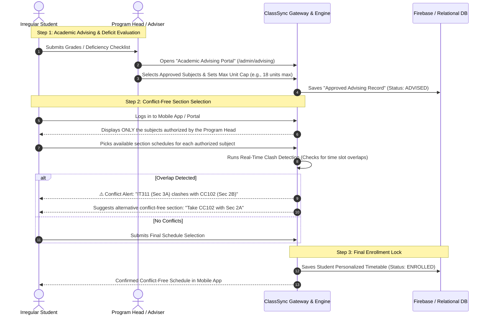

# Academic Advising & Enrollment Workflow: Regular vs. Irregular Students

## 1. The University Reality

Your classmate is **100% correct**. This is standard university operating procedure in Philippine State Universities and Colleges (SUCs/LUCs) like Colegio de Montalban:

* **Regular Students:** Enrolled in a **fixed, pre-approved block schedule** (e.g., `BSIT-3A` taking exactly 21 units prescribed by the prospectus). No custom evaluation is needed because their curriculum pathway is predetermined.
* **Irregular Students:** **Cannot self-enroll without Program Head Academic Advising.** They carry back-subjects, failed prerequisites, retakes, or unit deficiencies. The Program Head must manually evaluate their transcript/grades, enforce prerequisite rules, and formally authorize an **Advising Slip / Evaluation Form** specifying the exact subjects and total units they are allowed to take.

---

## 2. The 3-Step Irregular Advising & Scheduling Workflow

To model this accurately in ClassSync without creating bottlenecks, the system implements an **Advising & Conflict-Free Enrollment Pipeline**:



---

## 3. How ClassSync Implements This in Code & Database

### A. The Advising Record Schema (`advising_records`)
Before an irregular student can select timeslots, an advising record must exist in the database:

```json
{
  "advising_id": "ADV-2026-0012",
  "student_id": "2024-00123",
  "academic_year": "2026-2027",
  "semester": "1st Semester",
  "program_head_id": "FAC-ICS-HEAD",
  "max_allowed_units": 18,
  "status": "APPROVED",
  "advising_date": "2026-08-15T09:30:00Z",
  "authorized_subjects": [
    {
      "subject_code": "CC102",
      "subject_title": "Data Structures & Algorithms",
      "units": 3,
      "is_prerequisite_cleared": true
    },
    {
      "subject_code": "IT311",
      "subject_title": "Mobile Application Development",
      "units": 3,
      "is_prerequisite_cleared": true
    },
    {
      "subject_code": "GE-ETHICS",
      "subject_title": "Ethics",
      "units": 3,
      "is_prerequisite_cleared": true
    }
  ]
}
```

### B. Security & Validation Rules (Sir Mades & Sir Nat)
1. **Zero Unauthorized Subjects:** If an irregular student attempts an API request `POST /api/v1/student/enroll` with a subject not on their approved Advising Record, the Gateway returns `403 Forbidden` (`UNAUTHORIZED_SUBJECT_SELECTION`).
2. **Unit Overload Protection:** The system automatically sums the units:
   $$\sum \text{Enrolled Units} \le \text{Max Allowed Units authorized by Program Head}$$
   If a student tries to add a 4th subject pushing them over their 18-unit limit, the system blocks it.

---

## 4. Why This Will Blow Away Your Defense Panel

When the defense panel asks:
> *"How does your system handle irregular students who have back-subjects?"*

Your team presents this exact answer:

> *"ClassSync separates regular and irregular enrollment workflows: Regular students are automatically assigned to their pre-computed section block schedule. For irregular students, our system complies with university academic advising policies: the Program Head accesses the **Academic Advising Module** to evaluate deficiencies and approve an authorized subject list with an official unit cap. Once approved, the irregular student uses the mobile app to pick open sections for those exact authorized subjects—where our real-time constraint validator ensures none of their selected classes overlap in time or exceed room capacities."*
