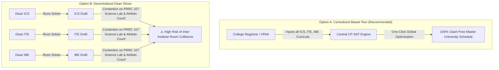
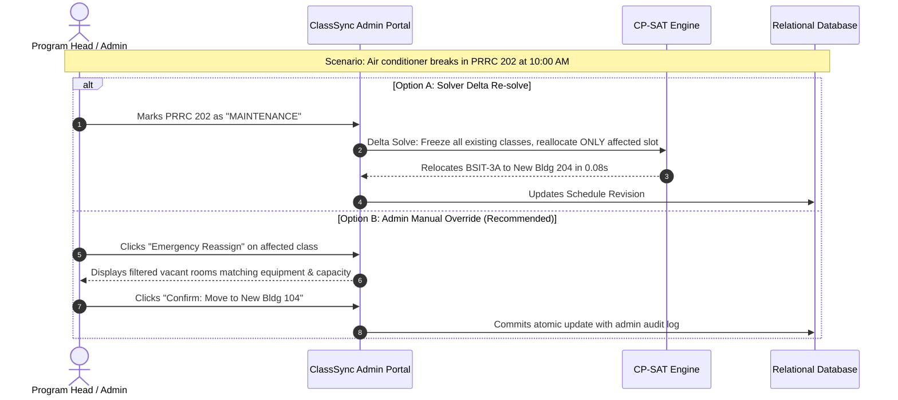
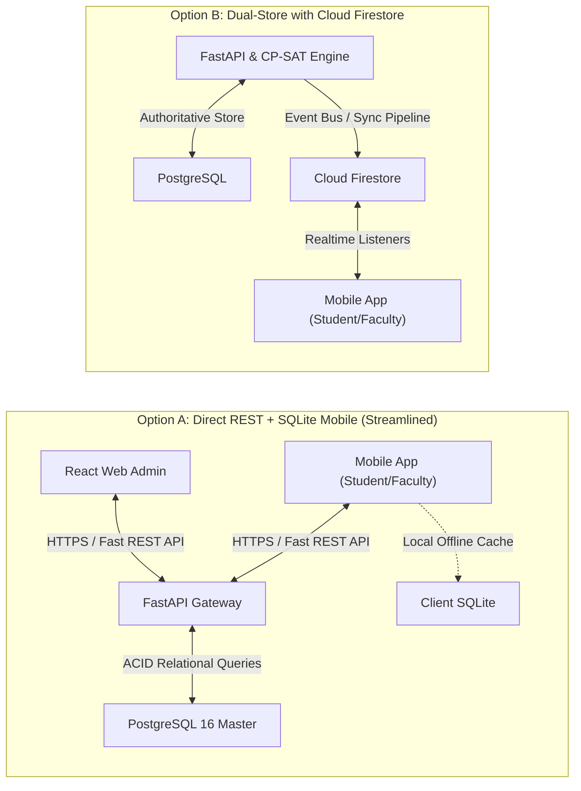
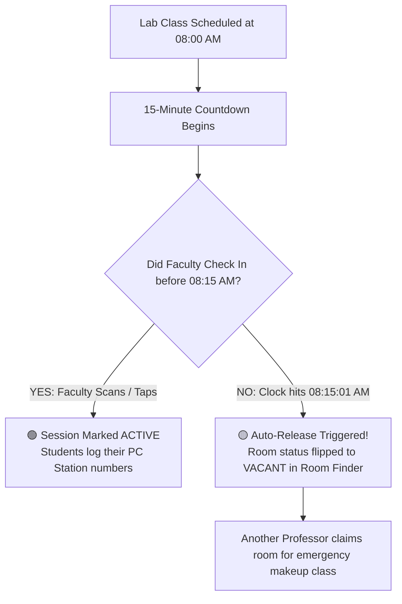

# ClassSync: Architectural Decisions & Group Alignment Guide
## Capstone Team Blueprint & Decision Matrix Before Implementation

**Project Title:** ClassSync — University Classroom Scheduling, Room Availability, and Conflict Prevention System  
**Target Institution:** Colegio de Montalban (CdM) — Kasiglahan Village, Rodriguez, Rizal  
**Prepared By:** Lead Systems Architect  
**Target Audience:** Capstone Groupmates, Developers, and Technical Advisers  
**Document Status:** Ready for Team Consensus & Sign-Off  

---

## 1. Executive Context: Why We Must Decide These NOW

Before writing any backend microservices, CP-SAT constraint rules, or mobile screens, our group must agree on **four fundamental architectural crossroads**. 

In software engineering, changing a database schema or distributed communication pattern mid-development costs **10x to 50x more time** than deciding it upfront. Moreover, our panel of professors (**Sir Nat, Sir Mades, Ma'am Gretchen, Ma'am Lamadora**) will test these exact architectural boundaries during our defense.

This document breaks down each decision in **plain English and Taglish**, compares the options, highlights the grading panel's perspective, and provides our **recommended architectural choice**.

---

## 2. Decision Matrix Summary (Quick View)

| # | Architectural Crossroad | Option A | Option B | Recommended Choice |
| :-: | :--- | :--- | :--- | :-: |
| **1** | **Solver Orchestration** | **Centralized Campus Batch** (Registrar solves all 3 institutes & 51 rooms together) | **Decentralized Dean Slices** (Each Dean generates their own draft independently) | **Option A (Centralized)** |
| **2** | **Emergency Room Reassignment** | **Automated Solver Delta** (CP-SAT re-solves affected slot in $<0.1\text{s}$) | **Admin Manual Override** (Admin picks from real-time Room Finder suggestions) | **Option B (Manual Override) with Delta fallback** |
| **3** | **Database & Mobile Sync** | **Direct REST + Offline SQLite** (PostgreSQL as single source of truth + mobile local cache) | **Dual-Store (PostgreSQL + Firestore)** (PostgreSQL for solver/drafts; Firestore for live mobile sync) | **Option A (Direct REST + SQLite)** *(unless Ma'am Gretchen mandates Firestore)* |
| **4** | **Lab Check-in & Auto-Release** | **Dynamic QR Code Scanner** (Rotating QR code on teacher projector / door) | **One-Tap Check-in + Wi-Fi Guard** (Faculty taps button while on campus network) | **Option A for Lab PCs, Option B for Faculty Presence** |

---

## 3. Deep Dive into the 4 Architectural Decisions

---

### Crossroad 1: Solver Orchestration — Centralized vs. Decentralized?

#### What It Means in Plain English:
* **Option A (Centralized Master Batch):** The Registrar or Schedulers input the curricula and sections of all 3 institutes (ICS, ITE, IBE) and hit *Generate*. The mathematical solver distributes classes across all 51 rooms simultaneously. Zero chance of cross-institute room collisions.
* **Option B (Decentralized Dean Slices):** Each Dean has their own admin panel and generates their schedule separately whenever they want.

#### The Taglish Translation:
> *"Sa Option A, isang pindot lang sa Registrar, buong CdM na ang naka-schedule nang sabay-sabay kaya garantisadong walang magkaagaw sa Science Lab o Gym. Sa Option B, kanya-kanyang gawa si ICS, ITE, at IBE. Ang problema, paano kung parehong pinili ni ICS at ITE yung PRRC 107 sa Monday 9 AM? Mag-aaway ang dalawang Dean."*

#### Defense Panel Perspective:
* **Sir Nat (API Microservices):** Prefers Option A because the solver orchestrator acts as a cohesive Process API with deterministic constraints.
* **Ma'am Lamadora (Methodology):** Option A allows us to present a formal mathematical proof ($X_{c,r,d,t} \le 1$) over the entire university domain.

#### Architect's Recommendation: **OPTION A (Centralized Campus Batch)**
* *Why:* CdM only has **one Science Lab (`PRRC 107`)** and **one Athletic Court**. Decentralized scheduling creates a distributed locking nightmare. Centralized generation is mathematically clean, easier to defend, and faster to implement.

---

### Crossroad 2: Emergency Room Reassignment — Solver Delta vs. Manual Override?

#### What It Means in Plain English:
* **Option A (Automated Delta Re-Solve):** The system uses CP-SAT in real-time. When a room breaks or teacher is absent, the solver "freezes" all existing schedules and recalculates a replacement room in $<0.1\text{ seconds}$.
* **Option B (Admin Room-Finder Override):** The admin clicks "Find Replacement Room", the system shows a live list of 100% vacant, compliant rooms, and the admin clicks to confirm.

#### The Taglish Translation:
> *"Sa Option A, si computer mismo ang maghahanap ng bagong room gamit ang algorithm kapag nasira ang projector sa isang classroom. Sa Option B, si Admin ang pipili sa screen mula sa listahan ng mga bakanteng rooms na sasalain ng app natin para hindi magkamali."*

#### Defense Panel Perspective:
* **Sir Nat:** Highly impressed if we demonstrate Delta Re-Solving ($<0.1\text{s}$) because it shows advanced microservice capability.
* **Sir Mades (Security & Governance):** Insists on an explicit human-in-the-loop audit trail. Fully automatic re-solving without admin approval might move students without faculty consent.

#### Architect's Recommendation: **HYBRID (Option B with Option A Suggestion Engine)**
* *Why:* The system runs the Delta Re-Solve algorithm in the background to rank the **Top 3 Best Replacement Rooms** (highest capacity fit, shortest walking distance), but requires the **Admin to click "Approve Reassignment"**. This satisfies both Sir Nat's algorithmic expectations and Sir Mades' administrative audit requirements.

---

### Crossroad 3: Database & Mobile Synchronization Strategy (Ma'am Gretchen's Rubric)

#### What It Means in Plain English:
* **Option A (Direct REST + Offline SQLite):** Everything is stored in our PostgreSQL database. When students open the mobile app, it fetches their schedule via our FastAPI backend and saves a copy in their phone's local SQLite database so it works even without internet.
* **Option B (Dual-Store with Cloud Firestore):** PostgreSQL is used by the admin and solver. Once approved, the published schedule is copied to Google Cloud Firestore so mobile devices get instant real-time synchronization.

#### The Taglish Translation:
> *"Sa Option A, isang database lang (PostgreSQL) ang maintain natin. Pag nag-offline si student sa campus, mababasa pa rin niya yung schedule niya dahil naka-save sa phone niya (SQLite). Sa Option B, dalawa ang database natin: PostgreSQL para sa solver, tapos Firebase Firestore para sa live sync ng mobile. Mas maangas si Option B, pero mas madaming kailangang i-code para hindi magka-desync."*

#### Defense Panel Perspective:
* **Ma'am Gretchen (Database & Mobile):** If her coursework specifically asks for Firebase Cloud Firestore, Option B is mandatory. If her rubric accepts relational database design with mobile offline capability, Option A is far superior.
* **Sir Mades:** Prefers Option A because Row-Level Security (RLS) and data privacy controls are centralized in one relational engine rather than duplicated in Firestore Security Rules.

#### Architect's Recommendation:
* **Verify with Ma'am Gretchen first.** 
* If Firestore is **NOT strictly mandatory**: Choose **Option A**. It saves weeks of writing synchronization webhooks and avoids Firestore monthly billing.
* If Firestore **IS mandatory for grading**: Implement Option B where Firestore is strictly a **Read-Only Projection** (the mobile app reads from Firestore, but all writes must go through FastAPI to PostgreSQL).

---

### Crossroad 4: 15-Minute Lab Accountability & Auto-Release Mechanism

#### What It Means in Plain English:
* **Option A (Dynamic QR Code):** The teacher's desktop in the lab displays a QR code that changes every 30 seconds. Faculty and students scan it with their phone camera to log their attendance and exact PC station number.
* **Option B (One-Tap Check-in with Campus Wi-Fi Detection):** The professor simply opens the ClassSync app and taps "Check-in to Lab". The app verifies they are connected to the official CdM campus Wi-Fi.

#### The Taglish Translation:
> *"Sa Option A, may QR code sa monitor ng teacher. I-i-scan ni student gamit ang phone para ma-record kung saang PC number siya nakaupo (iwas nakawan ng mouse o keyboard). Sa Option B, pipindutin lang ni Prof ang 'Check-in' button sa app habang naka-connect sa Wi-Fi ng school para hindi ma-release yung lab."*

#### Defense Panel Perspective:
* **Sir Mades (Security & Auditing):** Loves Option A for the computer laboratories because tracking `student_id -> pc_station_number` creates physical accountability for damaged hardware.
* **Ma'am Lamadora & Sir Nat:** Option B is simpler to demonstrate live during the capstone defense without needing multiple mock phones scanning monitors.

#### Architect's Recommendation: **TWO-TIER IMPLEMENTATION**
1. **Tier 1 (Faculty Attendance):** **Option B (One-Tap Check-in with 15-minute countdown timer).** Simple, fool-proof, and easy to demonstrate during the defense.
2. **Tier 2 (Student Hardware Station Logging):** **Option A (Simple QR Code or Manual Station Picker: e.g., PC-01 to PC-40).** Students select their station to fulfill the inter-institute hardware protection requirement.

---

## 4. Team Voting & Sign-Off Matrix

Please have each team member write their preferred choice and signature/initials below:

| Team Member Name | Role in Capstone | Decision 1 (Solver) | Decision 2 (Reassign) | Decision 3 (Database) | Decision 4 (Check-in) | Signature / Date |
| :--- | :--- | :---: | :---: | :---: | :---: | :---: |
| **Renmaur (Lead)** | Lead Systems / Full-Stack | `[ A / B ]` | `[ A / B ]` | `[ A / B ]` | `[ A / B ]` | `_____________` |
| **Member 2** | Backend / Solver Dev | `[ A / B ]` | `[ A / B ]` | `[ A / B ]` | `[ A / B ]` | `_____________` |
| **Member 3** | Frontend / UI-UX | `[ A / B ]` | `[ A / B ]` | `[ A / B ]` | `[ A / B ]` | `_____________` |
| **Member 4** | Mobile App Dev | `[ A / B ]` | `[ A / B ]` | `[ A / B ]` | `[ A / B ]` | `_____________` |

---

## 5. What Happens Immediately After Team Sign-Off?

The moment our team locks in these 4 choices:
1. **Backend Contract Generation:** We will finalize the typed Pydantic request/response schemas in `packages/api-contracts/`.
2. **Database Migrations:** We will apply the finalized relational schema migrations in `packages/persistence/`.
3. **Solver Constraints:** We will lock the CP-SAT mathematical model in `services/scheduling/` to guarantee clash-free outputs.
4. **UI Wireframe Freezing:** Frontend and Mobile developers can begin building screens without fear of sudden requirement shifts.

---
*Document saved in: `docs/academic/ARCHITECTURAL_DECISIONS_AND_GROUP_ALIGNMENT.md`*  
*Ready for team printing, review, or presentation in your next group meeting.*