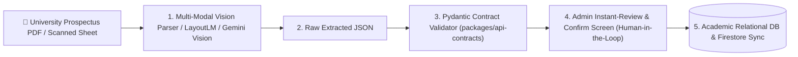
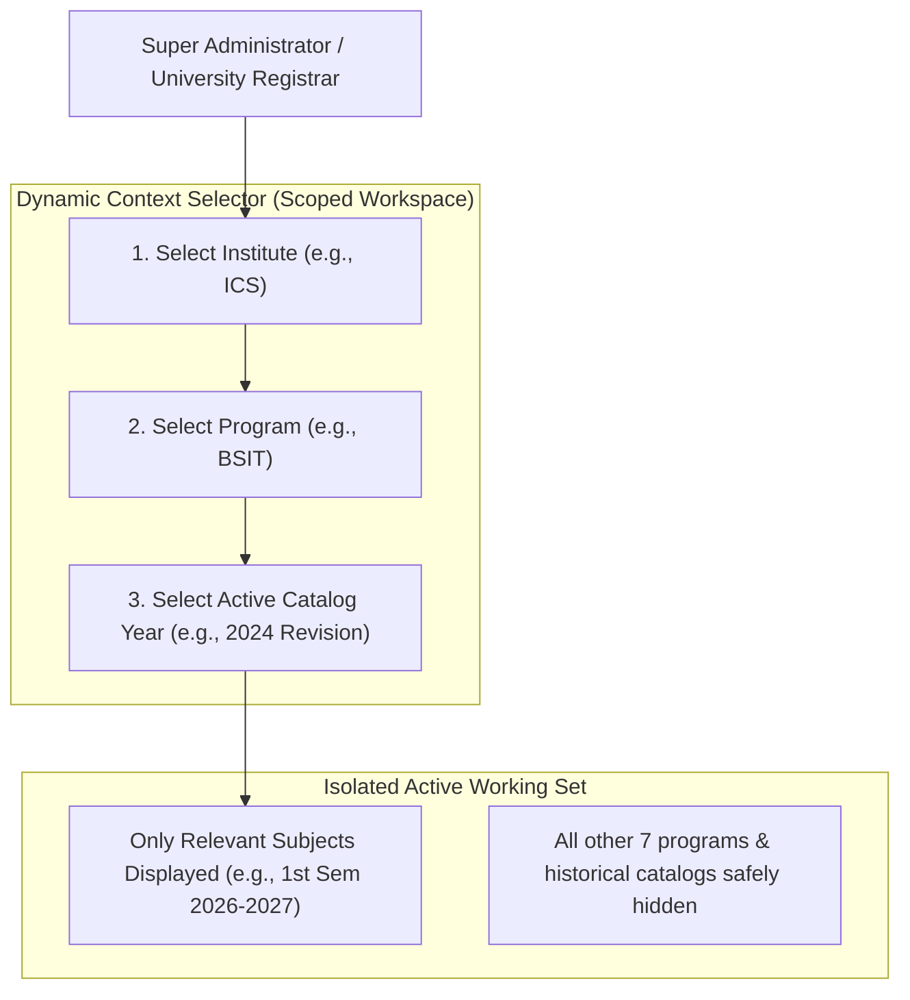

# Automated Curriculum Ingestion & Administrative Scope Architecture

## 1. Automated Curriculum Ingestion: Beyond Traditional OCR

To eliminate manual data entry of multi-page PDF prospectuses across 8+ degree programs, ClassSync implements an **Automated Document Ingestion Pipeline**.

### Why Traditional OCR Fails for University Prospectuses
* **Table Misalignment:** Traditional OCR extracts raw text without understanding tabular grid relationships (e.g., mixing up Lecture vs. Lab hours or Prerequisites).
* **High Error Rate:** Scanned document artifacts produce garbled course codes (e.g., `IT311` read as `1T31!`).

### The Advanced Modern Architecture: Multi-Modal Document Parsing + Schema Validation

1. **Vision-Language / Layout-Aware Parsing:**
   - Extracts bounding boxes and structured table grids directly from PDFs (via Google Document AI or multi-modal LLM Vision).
   - Maps table headers (`Course Code`, `Descriptive Title`, `Lec Units`, `Lab Units`, `Pre-requisite`) directly to target schema fields.
2. **Schema Sanitization & Verification (Sir Nat - Microservices):**
   - The ingested output passes through strict Pydantic schemas in `services/academic` to ensure units, codes, and prerequisites conform to university rules.
3. **Human-in-the-Loop Verification (ITHUMCI / Ma'am Lamadora):**
   - The administrator is presented with a pre-filled grid to verify and click **[Approve & Import]**, ensuring 100% data fidelity in seconds without typing.

---

## 2. Preventing Multi-Program "Clutter" with Scoped Administration

### The Problem
When one central Administrator is responsible for 3 institutes and 8+ degree programs (with both old and new curriculums), the interface risks severe cognitive overload and navigation clutter.

### The Solution: Scoped Faceting & The "Active Term Working Set" Pattern

1. **Scoped Workspace Filtering:**
   - The UI never dumps all programs onto a single screen.
   - The top navigation features a persistent context picker:  
     `Institute: [ICS ▼]  >  Program: [BSIT ▼]  >  Catalog: [2024 Revised ▼]`
   - Changing the picker instantly isolates that program's catalog without noise from Teacher Education or Business.
2. **The "Active Term" Working Set:**
   - In any given scheduling run, the university is only scheduling **one active semester** (e.g., 1st Semester AY 2026–2027).
   - The system automatically hides the other 7 semesters of a 4-year curriculum, showing only subjects active for the current scheduling cycle.
3. **Template Cloning / Catalog Duplication:**
   - When a new curriculum version is introduced, the administrator can simply click **"Clone from 2019 Revision"**, modify only the 2 or 3 changed subjects, and save. No need to start from scratch.
