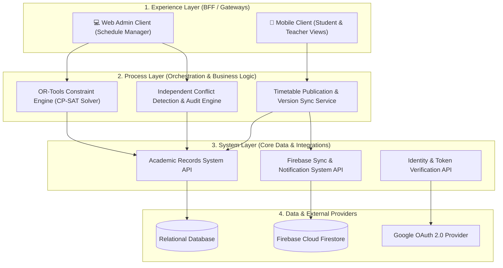

# ClassSync — Capstone Alignment & Development Methodology

## 1. Executive Summary: 5-Course Integration

ClassSync is designed as a collaborative capstone project integrating five distinct academic requirements into a cohesive enterprise architecture:

| Course / Subject | Instructor | Core Deliverable | Role in ClassSync |
| :--- | :--- | :--- | :--- |
| **API Microservices (Backend)** | Sir Nat | Distributed backend services, routing, API orchestration | **FastAPI Microservices** (`services/gateway`, `services/academic`, `services/scheduling`, `services/notification`) communicating via typed API contracts. |
| **Security** | Sir Mades | Identity management, RBAC, authorization boundaries, audit trails | **OAuth 2.0 / Firebase Token verification**, role-based access (`student`, `teacher`, `administrator`), Pydantic schema validation, and immutable draft audit logging. |
| **Database (Firebase)** | Ma'am Gretchen | Cloud NoSQL persistence, real-time sync, data rules | **Cloud Firestore** for real-time published schedule queries, room status reflection, mobile notifications, and Firestore security rules. |
| **Mobile Application** | Ma'am Gretchen | Mobile UI/UX, responsive views, portable access | **Student & Teacher Mobile Client** (daily timetable, real-time room availability finder, clash alerts). |
| **Manuscript** | Ma'am Lamadora | Technical documentation, system architecture, research paper | **Chapters 1–5 documentation** containing system architecture diagrams, API-Led topologies, schema dictionaries, and test evaluation matrices. |

---

## 2. Architectural Pattern: API-Led Integration

The system adheres to an **API-Led Integration Architecture** spanning three tiers to decouple subsystems:

* **Experience APIs (`/api/v1/*`):** Tailored payloads for Mobile (fast, low-data, room-finder) and Web Admin (heavy batch management).
* **Process APIs:** Encapsulate scheduling algorithms (Google OR-Tools) and conflict detection without exposing raw calculation models directly to clients.
* **System APIs:** Encapsulate direct database operations and security boundaries.

---

## 3. Development Methodology: Schema-Driven Development (SDD)

Instead of a traditional Waterfall approach, ClassSync implements **Specification-Driven Development (SDD) / API-First Development** managed within an **Agile lifecycle**:

1. **Contract-First (`packages/api-contracts` & `packages/shared-types`):**
   - API schemas, Pydantic models, and TypeScript types are defined *before* coding starts.
2. **Parallel Team Execution:**
   - **Backend Team (Sir Nat):** Implements endpoints strictly against the pre-agreed contract.
   - **Mobile Team (Ma'am Gretchen):** Builds UI screens against typed mock contracts without waiting for backend deployment.
   - **Security Team (Sir Mades):** Configures token authentication and schema validation rules at the gateway perimeter.
   - **Database Team (Ma'am Gretchen):** Structures Firestore collections to mirror contract interfaces.
3. **Manuscript Integration (Ma'am Lamadora):**
   - Pre-formalized specifications, ERDs, and sequence diagrams directly populate Chapter 3 (Methodology & Design).
