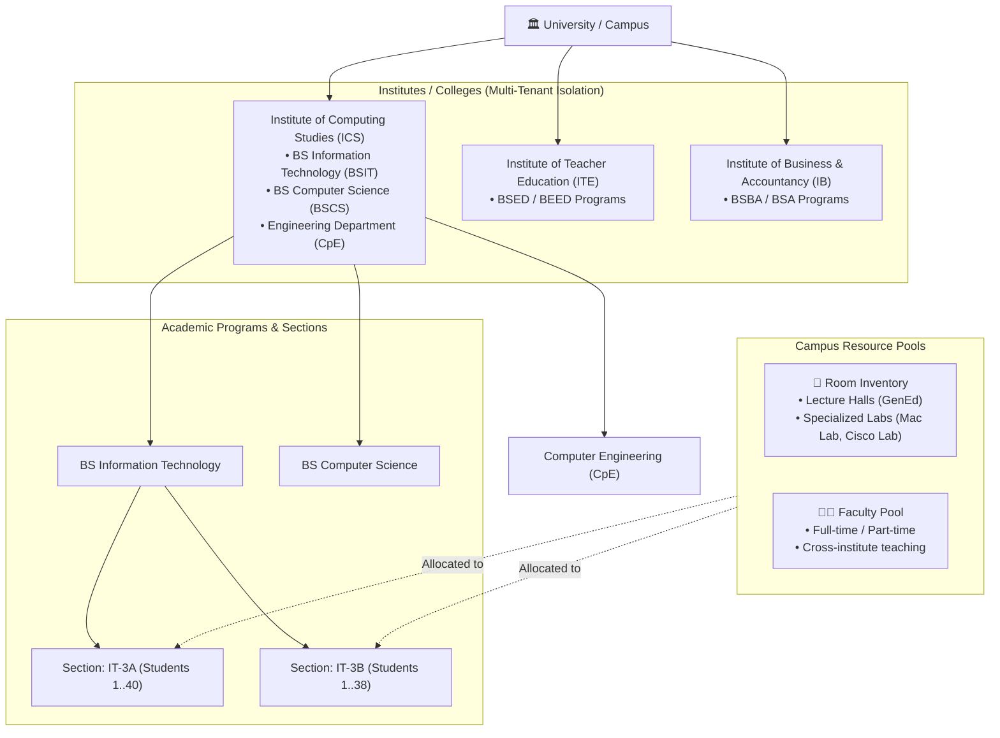

# Multi-Entity Hierarchy & Schedule Management: Institutes, Rooms, and Students

## 1. Multi-Tier Academic Hierarchy

To prevent scheduling clashes across an entire university, ClassSync models institutional data in a strict hierarchical structure:

---

## 2. Entity Management Matrix

### 1. Institutes / Colleges (Multi-Tenancy & Scope)
* **The Problem:** Different institutes (e.g., Computing Studies with Engineering vs. Teacher Education vs. Business) have different curriculums, operating policies, and dean approvals.
* **How ClassSync Handles It:**
  - **Scoped Administration:** Institute coordinators only manage courses, faculties, and sections within their own institute (`tenant_id` / `institute_id`), while Engineering programs (like CpE) reside structurally under ICS administration.
  - **Shared vs. Dedicated Resources:** General lecture rooms can be shared campus-wide, while specialized rooms (e.g., Computer Labs, Chemistry Labs) are assigned priority to specific institutes.
  - **GenEd Coordination:** Cross-institute general education subjects (Math, History, PE) are harmonized through the central Gateway to avoid inter-departmental scheduling deadlocks.

---

### 2. Rooms & Physical Facilities
* **The Problem:** Room double-booking, capacity violations (50 students in a 30-seat room), and equipment mismatches (scheduling a coding class in a room without computers).
* **How ClassSync Handles It:**
  - **Metadata Profiling:** Each room holds `capacity`, `type` (`lecture`, `computer_lab`, `science_lab`), and `equipment_tags` (`projector`, `aircon`, `cisco_rack`).
  - **Hard Constraint Enforcement (Zero Overlap):**
    $$\text{Room}(R) \text{ at Time}(T) \le 1 \text{ active section}$$
  - **Capacity Safeguard:**
    $$\text{Section Enrollment Size} \le \text{Room Capacity}$$
  - **Live Room Availability Finder (Mobile App):**
    - Instant color-coded query for students/teachers:
      - 🟢 **Available:** No active booking for the current period.
      - 🔴 **Occupied:** Displaying current class, instructor, and until what time.
      - 🟡 **Reserved / Maintenance:** Temporarily locked.

---

### 3. Students & Cohorts (Section-Based Scheduling)
* **The Problem:** Tracking individual students in a university of 10,000+ students directly inside an optimization solver causes combinatorial explosion (server slowdown).
* **How ClassSync Handles It (Cohort/Section-Based Modeling):**
  - **Cohort Grouping:** Students are grouped into **Sections** (e.g., `BSIT-3A`, `BSCS-2B`). 
  - **Zero Student Clash:** Because all students in `BSIT-3A` take the same core block schedule, the CP-SAT engine guarantees that no two subjects assigned to `BSIT-3A` overlap in time:
    $$\text{Section}(S) \text{ at Time}(T) \le 1 \text{ class}$$
  - **Individual Mobile Projection (Firebase):**
    - When a student signs in with Google OAuth, their verified email maps to their enrolled Section.
    - Cloud Firestore pushes only their specific section's timetable directly to their mobile dashboard.
    - **Elective / Irregular Student Handling:** Irregular students select their individual subjects; the system audits their custom matrix and flags if two chosen subjects share the same time slot.

---

## 3. How the 5 Courses Benefit from this Structure

1. **Security (Sir Mades):**  
   - Multi-tenant data isolation: An Admin from the *Institute of Business* cannot view, modify, or publish schedule drafts belonging to the *Institute of Computing Studies*.
2. **API Microservices (Sir Nat):**  
   - `services/academic` maintains institute, room, and section registries.
   - `services/scheduling` runs constraint checks across rooms and sections.
3. **Database / Firebase (Ma'am Gretchen):**  
   - Hierarchical Firestore collections:
     - `/institutes/{instituteId}/rooms/{roomId}` (Live status)
     - `/institutes/{instituteId}/sections/{sectionId}/schedule` (Student feed)
4. **Mobile Application (Ma'am Gretchen):**  
   - Student taps their section (`BSIT-3A`) to see their weekly schedule.
   - Search bar: "Find an empty computer lab right now in the ICS building."
5. **Manuscript (Ma'am Lamadora):**  
   - Chapter 3 includes the **Multi-Tenant Entity-Relationship Diagram (ERD)** and the **Mathematical Constraint Formulation**.
