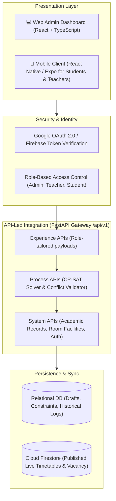

# ClassSync Capstone Executive Summary: Strengths, Weaknesses, and Defense Blueprint

This document synthesizes all architectural and academic decisions established for **ClassSync** across the five collaborating courses:
- **API Microservices (Backend):** Sir Nat
- **Security:** Sir Mades
- **Database (Firebase):** Ma'am Gretchen
- **Mobile Application:** Ma'am Gretchen
- **Manuscript:** Ma'am Lamadora

---

## 1. System Strengths (The Winning Selling Points for Defense)

| Core Strength | Why It Is Strong | Which Professor Loves It |
| :--- | :--- | :--- |
| **1. Multi-Course Architectural Unity** | Unlike fragmented group projects, ClassSync integrates Microservices, Mobile, Cloud NoSQL, and Enterprise Security into a single cohesive system. | All 5 Professors |
| **2. API-Led Integration Architecture** | Decouples the system into 3 formal tiers (**Experience APIs**, **Process APIs**, and **System APIs**). The mobile client never experiences lag from heavy constraint solver calculations. | **Sir Nat** (Microservices) & **Ma'am Lamadora** (Manuscript) |
| **3. Mathematically Sound Engine (OR-Tools CP-SAT)** | Schedule generation is backed by Google OR-Tools constraint satisfaction rather than crude random generation or naive loops, mathematically guaranteeing zero double-booked rooms or teachers. | **Sir Nat** & **Ma'am Lamadora** |
| **4. Pre-Computation Feasibility Gate** | The system audits contact-hour demand vs. room supply *before* running the solver. It eliminates server crashes and gives immediate traffic-light diagnosis (🟢 Ready vs. 🔴 Infeasible Deficit). | **Sir Nat** & **Sir Mades** (Prevents DoS/CPU exhaustion) |
| **5. Dual-Database Harmony (PostgreSQL + Firebase)** | Heavy relational scheduling data lives in a structured relational database, while published active schedules project into Cloud Firestore for real-time mobile sync. | **Ma'am Gretchen** (Database) |
| **6. Real-World Academic Life Compliance** | Supports Colegio de Montalban (CdM) institutional constraints: 7:00 AM – 7:00 PM operating band, mandatory lunch protections, multi-curriculum versioning (old vs. new), and dedicated irregular advising with backload seat-capacity tracking. | Panelists & Dean |
| **7. Schema-Driven Development (SDD)** | API schemas (`packages/api-contracts`) are established first, allowing backend and mobile teams to build concurrently without blocking each other. | Defense Panel (Industry standard) |

---

## 2. System Weaknesses & Vulnerabilities (What Panelists Might Attack & How to Defend)

Every real-world system has trade-offs. Knowing your weaknesses and having ready-made defense answers is how you earn top marks.

| Potential Weakness / Attack Angle | Why It Exists | Your Defense Script (How to Answer the Panel) |
| :--- | :--- | :--- |
| **1. Combinatorial Explosion on Full Campus Batches** | If an admin attempts to schedule all 3 institutes (ICS, ITE, IBE) and 50+ sections in a single solver run, memory and time spike exponentially. | *"To prevent combinatorial bottlenecks, ClassSync uses **hierarchical batch scheduling**. Dedicated institute labs and major subjects schedule in isolated Phase 1 batches, while Phase 2 only harmonizes shared GenEd rooms and cross-department faculty."* |
| **2. Irregular Student Slot Exhaustion** | If regular blocks are completely full (e.g., 45/45 capacity), irregular students cannot join that specific section. | *"This is an intentional real-world safeguard. The system forbids classroom over-enrollment to respect physical fire and room safety codes. When a block is full, our mobile app dynamically surfaces open alternative sections or flags the deficit for Program Head intervention."* |
| **3. Mobile Battery & Data Usage on Real-Time Sync** | Constantly listening to Firestore updates can drain mobile device resources. | *"We implement shallow root queries and scoped document listeners (`published_schedules/{sectionId}`). The mobile app only listens to changes affecting that specific student's enrolled section, minimizing Firebase reads, data consumption, and battery drain."* |
| **4. Human Dependency in Academic Advising** | An irregular student cannot enroll until the Program Head evaluates and encodes their Advising Record. | *"This reflects strict university compliance. State universities forbid irregulars from self-enrolling without prerequisite evaluation. ClassSync speeds up this process by providing the Program Head with a 1-click deficiency audit tool."* |
| **5. PDF Ingestion OCR Errors** | Scanned prospectuses with poor resolution or damaged ink might cause parsing mistakes. | *"To prevent flawed data ingestion, our pipeline includes a mandatory **Human-in-the-Loop review screen**. The administrator verifies the extracted grid and clicks approve before any record is committed to the database."* |

---

## 3. High-Level System Architecture Summary

---

## 4. Groupmate Taglish Briefing Script (Ready to Copy-Paste into GC)

> **"Guys, eto yung buong summary ng system natin (ClassSync) para pare-parehas tayo ng sasabihin sa defense at alam natin yung Strengths at Weaknesses natin:**
>
> ### 🏆 Strongest Points Natin (Bakit Papasa 'to):
> 1. **Kumpleto sa 5 Subjects:** Pasok kay Sir Nat (Microservices), Sir Mades (Security), Ma'am Gretchen (Firebase + Mobile App), at Ma'am Lamadora (Manuscript).
> 2. **API-Led Integration:** Hindi babagal ang mobile app dahil may sariling Experience API ang mobile na magaan lang, habang yung mabigat na solver nasa hiwalay na Process Layer.
> 3. **Totoong Scheduling Engine (OR-Tools CP-SAT):** Hindi tayo gumawa ng fake o random schedule; gumagamit tayo ng mathematical constraint solver para siguradong zero-clash ang rooms at teachers.
> 4. **Pre-Computation Check:** Bago mag-generate ng schedule, chine-check muna ng system kung kasya ba ang classroom hours vs demand para maiwasan ang server crash.
> 5. **Solusyon sa Irreg at CdM Rules:** Nasunod natin yung 7 AM – 7 PM window, lunch break protection, at yung kailangan munang dumaan si irreg sa Program Head advising bago makapili ng regular slots na may bakanteng upuan.
>
> ### ⚠️ Weaknesses na Pwedeng Itanong ng Panel & Sagot Natin:
> 1. *'Paano kung sabay-sabay i-schedule buong school, di ba babagal?'*  
>    **Sagot:** Hindi, dahil **hierarchical batching** tayo—inuuna muna ang bawat Institute bago i-harmonize ang shared general rooms.
> 2. *'Paano kung puno na yung classroom, paano si irreg?'*  
>    **Sagot:** Safeguard talaga yun para hindi mag-overcrowd ang room. Magsu-suggest ang app ng ibang section kung saan may bakanteng slot.
> 3. *'Bakit kailangan pa ng advising kay Program Head, bakit di na lang mag-enroll agad si irreg?'*  
>    **Sagot:** Standard university policy ng CdM yun para masigurong pumasa sa prerequisite bago mag-take ng higher subject.
>
> Lahat ng architecture docs at diagrams naka-save na sa `docs/academic/` folder ng project natin!"
