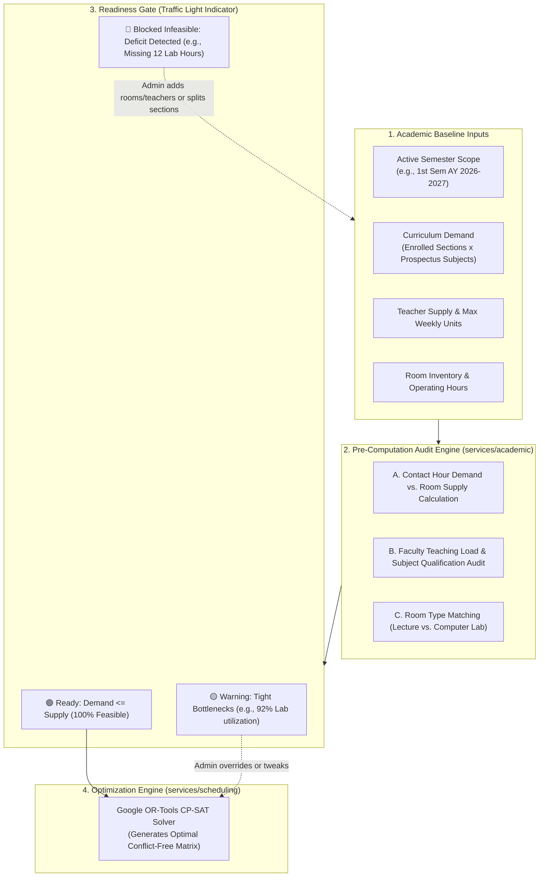

# Pre-Computation & Capacity Audit Pipeline (Before Automated Scheduling)

## 1. The Core Problem: Why Direct Generation Fails
If an AI/solver algorithm attempts to generate a timetable blindly without pre-calculating resource capacity, one of two failures occurs:
1. **Mathematical Infeasibility (`INFEASIBLE`):** The solver runs for minutes or hours and crashes or returns no schedule because there physically aren't enough rooms or teacher hours to satisfy the curriculum.
2. **Combinatorial Explosion:** Trying to calculate everything at once across an entire university causes server timeouts.

To solve this, ClassSync implements an automated **Pre-Computation & Feasibility Audit Pipeline** before any schedule generation is triggered.

---

## 2. The 4-Stage Pre-Computation Audit Pipeline



---

## 3. Mathematical Formulas Used in Pre-Computation

### A. Room Capacity & Contact Hour Audit
Before placing a single class, the system calculates the **Total Required Room Hours** vs. **Total Available Room Hours**:

1. **Demand (Weekly Hours Needed):**
   $$\text{Total Lab Demand} = \sum (\text{Sections} \times \text{Lab Hours per Subject})$$
   $$\text{Total Lecture Demand} = \sum (\text{Sections} \times \text{Lecture Hours per Subject})$$

2. **Supply (Weekly Operating Hours Available):**
   $$\text{Room Supply} = \text{Count of Usable Rooms} \times \text{Operating Hours per Week (e.g., Mon–Sat 7AM–7PM = 72 hrs)}$$

3. **Utilization Ratio Check:**
   $$\text{Utilization Ratio} = \frac{\text{Demand Hours}}{\text{Supply Hours}}$$
   * If $\text{Ratio} > 1.0 \implies$ **Mathematically Impossible (Deficit).** The system blocks generation immediately and reports: *"You need 140 Lab hours, but your 2 Computer Labs only provide 144 hours maximum (97% load). Recommend adding 1 lab or extending hours."*

---

### B. Teacher Workload & Qualification Audit
The system checks if faculty resources can handle the subject demand:

1. **Faculty Capacity:**
   $$\text{Teacher Supply} = \sum \text{Max Allowed Units per Instructor (e.g., 24 units for Full-time, 12 for Part-time)}$$
2. **Subject Qualification Check:**
   * Every subject in the prospectus has required specializations (e.g., `Data Structures` $\rightarrow$ Computing Faculty).
   * The audit confirms that at least one qualified teacher is available who has not exceeded their maximum weekly load.

---

### C. Institute Isolation vs. Campus Pooling
To prevent cross-institute chaos, scheduling runs in **hierarchical batches**:
1. **Tier 1: Departmental/Institute Phase**
   - Specialized rooms (e.g., ICS Computer Labs, Engineering Workshops) and core major subjects are scheduled first within their respective institute.
2. **Tier 2: General Education (GenEd) Harmonization**
   - Shared lecture halls (GenEd rooms) and cross-department faculty (Math, English, PE) are pooled through a central campus gate to prevent two institutes from claiming the same room at the same time.

---

## 4. What the Administrator Sees (The Pre-Generation Readiness Screen)

Before the Admin clicks **"Generate Schedule"**, they see an executive summary card:

```text
================================================================================
PRE-SCHEDULE FEASIBILITY AUDIT: 1st Semester AY 2026-2027
Target: Institute of Computing Studies (ICS) — 14 Sections
================================================================================
[✓] Academic Period:     1st Semester (Aug 2026 - Dec 2026)
[✓] Sections to Schedule: 14 Sections (BSIT & BSCpE)
[✓] Contact Hour Demand:  420 Total Weekly Hours
    - Lecture Hours:     260 hrs  | Capacity Available: 576 hrs (45% Utilized) [OK]
    - Laboratory Hours:  160 hrs  | Capacity Available: 216 hrs (74% Utilized) [OK]
[✓] Faculty Load Check:   18 Instructors available | Total Demand: 378 units (OK)
--------------------------------------------------------------------------------
STATUS: 🟢 READY FOR GENERATION (Estimated Solver Runtime: ~4.2 seconds)
[ BUTTON: Start Automated Schedule Generation ]
================================================================================
```

If a deficit is detected (e.g., not enough rooms), the button is disabled, and the exact bottleneck is displayed (e.g., *"Deficit: 18 Lab hours short for 3rd Year BSIT. Please allocate Lab 3 or adjust section counts."*).

---

## 5. Course Alignment Benefits

* **Sir Nat (API Microservice):** Pre-computation is exposed as a lightweight diagnostic endpoint (`GET /api/v1/scheduling/readiness-check`) separated from the heavy solver (`POST /api/v1/scheduling/generate`).
* **Sir Mades (Security):** Prevents Denial-of-Service (DoS) and server CPU exhaustion by rejecting impossible constraint models before starting heavy solver calculations.
* **Ma'am Lamadora (Manuscript):** Populates Chapter 3 with formal feasibility formulas and capacity matrices.
