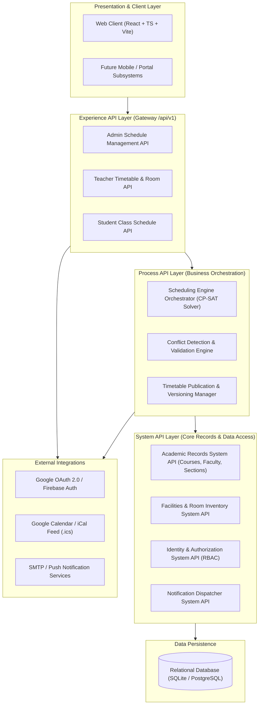
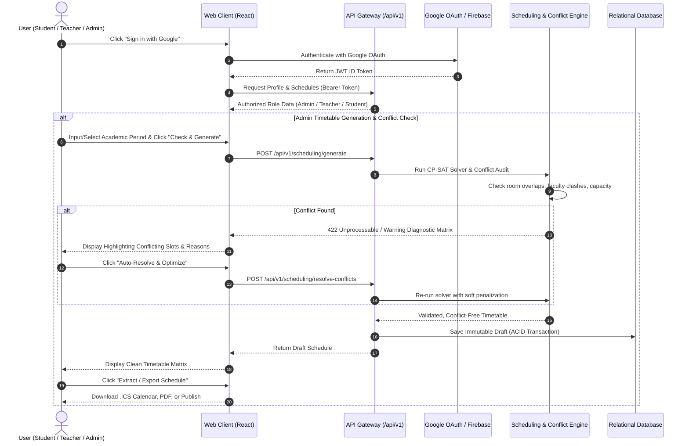

# Project Prompt & Engineering Specification: ClassSync

## 1. Project Prompt (Academic & System Brief)

> **System Title:** **ClassSync: Intelligent Classroom Scheduling, Room Availability, and Conflict Prevention System**
>
> **Project Brief:**
> Create a comprehensive, role-aware university classroom scheduling, room-availability, conflict-prevention, and timetable publication system titled **ClassSync**. Based on the system architecture, implement strict **Object-Oriented Programming (OOP)**, **Integration (External and Internal)**, and a robust **Relational Database** with ACID transaction guarantees.
> 
> For architectural integration, implement an **API-Led Integration Architecture** (Experience, Process, and System API layers) designed to seamlessly decouple and scale the core system across multiple academic subsystems (Academic Records, Constraint Scheduling Engine, Facilities & Room Inventory, and Notification Delivery).
>
> **Core Operational Purpose & Workflow:**
> The user (Student, Teacher, or Administrator) registers and logs in securely through **OAuth 2.0 (Google Authentication / Institutional SSO via Firebase Auth)**. Once authenticated:
> 1. The user inputs or views class schedules, section loads, faculty assignments, and room availability parameters.
> 2. The system's constraint engine automatically audits and checks the schedule for conflicts, room overlaps, instructor double-booking, capacity violations, and unassigned periods.
> 3. If conflicts or constraint violations are detected, the system immediately highlights the exact errors and root causes on an interactive schedule matrix.
> 4. The user can trigger automated conflict resolution (via constraint programming re-optimization) or apply recommended slot swaps.
> 5. A dedicated action button allows the user to **extract and export the validated, conflict-free timetable** (in PDF, iCal calendar sync, or CSV/JSON formats) or publish it directly to student and faculty portals.

---

## 2. API-Led Integration Architecture (Subsystems & Decoupling)

To support multi-subsystem scalability and enterprise extensibility, ClassSync organizes all internal and external communication into a three-tier **API-Led Integration** topology:



### 2.1 The Three API-Led Tiers
1. **Experience APIs (Edge / Gateway Layer - `/api/v1/*`):**
   - Exposes role-tailored payloads to the frontends (Student, Teacher, Administrator).
   - Validates Firebase OAuth tokens, applies CORS, rate limiting, and request correlation IDs (`X-Request-ID`).
   - Prevents private draft leakage to student and teacher interfaces.
2. **Process APIs (Business Logic & Engine Layer):**
   - **Scheduling Orchestrator:** Translates curriculum, room, and faculty constraints into mathematical constraints for Google OR-Tools CP-SAT.
   - **Conflict Detection & Validation:** Independently verifies generated schedules against hard constraints (zero overlaps) and soft constraints (pedagogical distribution).
   - **Publication Manager:** Computes timetable checksums, manages immutable revisions, and triggers notification broadcasts.
3. **System APIs (Data Access Layer):**
   - Interfaces directly with relational models (`AcademicService`, `RoomService`, `DraftRepository`).
   - Insulates database schema changes from scheduling optimization algorithms.

---

## 3. Object-Oriented Programming (OOP) Implementation

ClassSync implements OOP principles across both the Python FastAPI backend and the React/TypeScript frontend:

| OOP Principle | Backend Implementation (Python / OR-Tools) | Frontend Implementation (TypeScript / React) |
| :--- | :--- | :--- |
| **Encapsulation** | Domain entities (`Section`, `Instructor`, `Room`, `TimeSlot`) encapsulate validation rules, capacity limits, and operating hours behind private attributes and property getters/setters. | State management and client models encapsulate UI transformations, schedule matrix positioning, and time slot formatting. |
| **Abstraction** | Repository interfaces (`IAcademicRepository`, `IScheduleDraftRepository`) define clean contracts for data persistence, decoupling business logic from SQLite/PostgreSQL drivers. | Abstract API client wrappers hide raw fetch mechanics, authentication token headers, and network retries behind simple typed methods. |
| **Inheritance** | Base constraint classes (`AbstractConstraintRule`) extended by `RoomConflictRule`, `InstructorOverlapRule`, and `CapacityExceededRule`. | Base component models (`BaseModal`, `BaseScheduleGrid`) extended into role-specific timetable views (`StudentTimetable`, `AdminScheduleManager`). |
| **Polymorphism** | The conflict detection engine treats all validation rules uniformly through a polymorphic `.evaluate(schedule: ScheduleDraft) -> ValidationResult` method. | Dynamic schedule cell renderers polymorphically render lectures, laboratory sessions, or conflict warning badges based on slot type. |

---

## 4. Integration Specifications (External & Internal)

### 4.1 External Integrations
- **Google OAuth 2.0 / Firebase Authentication:**
  - Authenticates users securely via OpenID Connect (OIDC).
  - Issues signed JWTs verified server-side at the API Gateway.
  - Enforces three institutional roles: `student`, `teacher`, and `administrator`.
- **Calendar & Export Integration:**
  - Standard iCalendar (`.ics`) generation for one-click export into Google Calendar, Apple Calendar, and Microsoft Outlook.
  - PDF/Excel document rendering for official departmental schedule printouts.
- **External Notification Services (Planned):**
  - Webhooks and email alerts dispatched when an administrator publishes a revised timetable.

### 4.2 Internal Integrations
- **Inter-Service Communication:**
  - Asynchronous and synchronous HTTP/REST microservice contracts mediated by `packages/api-contracts`.
  - Structured error envelopes:
    ```json
    {
      "error": {
        "code": "ROOM_SCHEDULE_CONFLICT",
        "message": "Room CL-1 is already booked on Monday 09:00 - 10:30",
        "requestId": "c4b1d621-998f-48d2-8f6a-8451b6a48911"
      }
    }
    ```
- **Service Decoupling:**
  - `services/gateway` handles transport, authentication, and routing.
  - `services/academic` governs institutional records (programs, subjects, faculty availability).
  - `services/scheduling` executes OR-Tools optimization independently of academic storage.

---

## 5. Database Architecture & Persistence (Relational ACID)

- **Target Engine:** SQLite (local development) migrating to PostgreSQL (production).
- **Core Entities & Relationships:**
  - `Institutions` 1:N `Departments` 1:N `Programs` 1:N `Sections`
  - `Instructors` N:M `Subjects` (Teaching eligibility)
  - `Rooms` (Capacity, Laboratory/Lecture type, Equipment tags)
  - `AcademicPeriods` (Semester, Academic Year, Term dates)
  - `ScheduleDrafts` (JSON payload of planned slots, solver metadata, status: `draft` | `published`)
  - `ScheduleAssignments` (Draft ID, Section ID, Subject ID, Room ID, Instructor ID, DayOfWeek, StartTime, EndTime)
- **Integrity & Concurrency Controls:**
  - Unique composite constraints preventing duplicate assignments (`room_id + day_of_week + start_time`).
  - Foreign key cascading and strict check constraints for operating hour bounds (`07:00` to `21:00`).
  - Immutable published schedules with version hashing (SHA-256) to ensure tamper-proof audit trails.

---

## 6. End-to-End User Experience Workflow



---

## 7. Capstone Course Rubric Traceability

- **ITIASE1 (Information Architecture & Systems Enterprise Integration):**
  - Implemented through API-Led Integration (Experience, Process, and System APIs) connecting independent backend microservices.
- **ADBMS (Advanced Database Management Systems):**
  - Implemented through 3NF relational schemas, composite uniqueness constraints, transaction rollbacks, and audit versioning.
- **APPSDEV (Applications Development & Emerging Technologies):**
  - Implemented through React 18, TypeScript, FastAPI asynchronous backends, and Google OR-Tools constraint satisfaction.
- **ITHUMCI (Human-Computer Interaction):**
  - Implemented via WCAG 2.2 AA accessibility, responsive viewport support (360px to 1440px), color-contrast compliance, keyboard navigability, and immediate visual error feedback.
