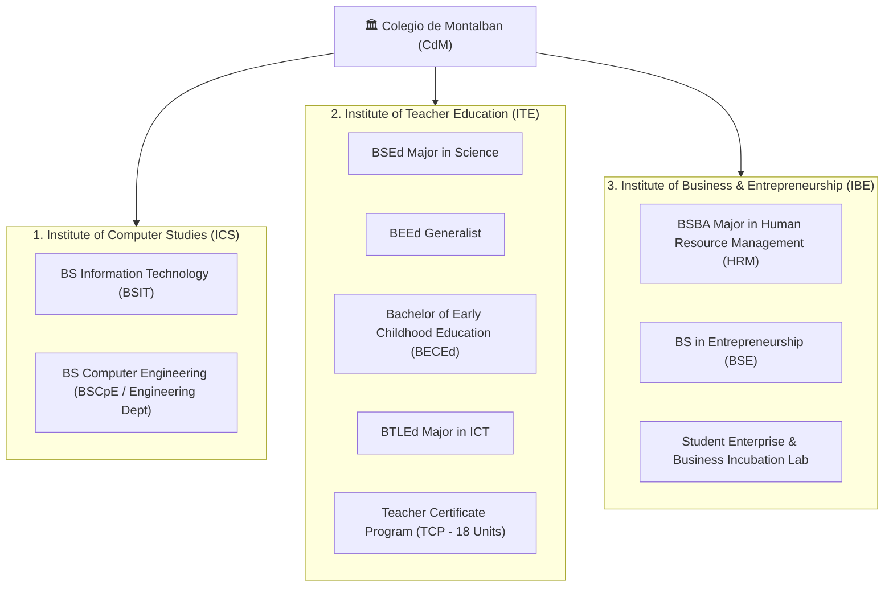
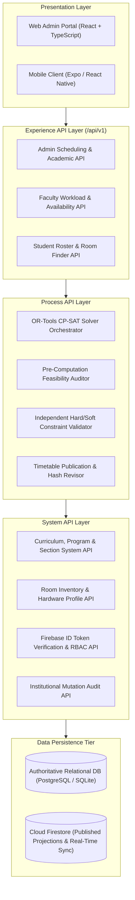

# ClassSync: Comprehensive System Overview & Academic Architecture

**System Title:** ClassSync: Intelligent Classroom Scheduling, Room Availability, and Conflict Prevention System  
**Target Institution:** Colegio de Montalban (CdM) — Kasiglahan Village, San Jose, Rodriguez, Rizal  
**Document Classification:** Authoritative System Blueprint & Cross-Course Capstone Reference  

---

## 1. Executive Summary & Purpose

**ClassSync** is an institutional-grade, role-based educational scheduling and facility management platform built specifically for higher education institutions in the Philippines. It solves the endemic challenges of manual timetabling, classroom double-booking, room capacity violations under CHED regulations, uncoordinated multi-institute facility sharing, and student schedule conflicts.

At its core, ClassSync integrates:
1. **Mathematical Optimization Solver:** Powered by **Google OR-Tools CP-SAT** to guarantee mathematically clash-free schedules across faculty, rooms, and student sections.
2. **Three-Role Dedicated Workspaces:** Distinct responsive interfaces for **Administrators / Deans**, **Faculty / Teachers**, and **Regular & Irregular Students**.
3. **Dynamic Campus Facility Management:** Granular tracking of physical classroom health, specialized laboratory equipment, and live room vacancy.
4. **Dual-Store Persistence Architecture:** An authoritative relational datastore for scheduling constraints, revisions, and audits, paired with Cloud Firestore for real-time mobile push synchronization.

---

## 2. Institutional Hierarchy: Institutes, Departments & Degree Programs

ClassSync organizes Colegio de Montalban into **three primary Institutes** (tenants), properly mapping engineering programs under computing studies:

### Institutional Scoping & Isolation
* **Tenant Scoping (`tenant_id`):** Institute Deans and department chairs only administer courses, sections, and faculty belonging to their respective institute.
* **Shared Cross-Cutting Curriculum (GenEd):** Foundational General Education subjects (Purposive Communication, Ethics, Mathematics in the Modern World, Understanding the Self, PE) are harmonized across all three institutes via the central Gateway to avoid inter-institute scheduling deadlocks.

---

## 3. Physical Campus Room Inventory & Facility Management

The campus inventory encompasses **51 distinct physical spaces (37 schedulable spaces + 14 administrative/shielded offices)** distributed across two primary multi-story buildings and an athletic court:

| Building / Area | Floor Level | Individual Physical Spaces | Count | Primary Designations & Lab Aliases |
| :--- | :--- | :--- | :--- | :--- |
| **PRRC** | Floor 1 | 101, 102, 103, 104, 105, 106, 107, 108, 109, 110 | 10 rooms | Room 108 = **ITE Science Lab (PRRC 107 - BSEd Science)**; 101–107, 109–110 = Lecture |
| **PRRC** | Floor 2 | 201, 202, 203, 204, 205, 206, 207, 208, 209, 210 | 10 rooms | General lecture classrooms |
| **PRRC** | Floor 3 | 301, 302, 303, 307, 308, 309, 310 | 7 rooms | 301 = **COMLAB1**, 302 = **VGA Room**, 303 = **COMLAB2**, 307 = **COMLAB3**, 308 = **COMLAB4**, 309–310 = Lecture |
| **New Building** | Floor 1 | 101, 102, 103, 104, 105, 106, 107, 108, 109, 110 | 10 rooms | General lecture classrooms |
| **New Building** | Floor 2 | 201, 202, 203, 204, 205, 206, 207, 208, 209, 210 | 10 rooms | General lecture classrooms |
| **New Building** | Floor 3 | 301, 302, 303, 304, 305, 306, 307, 308, 309, 310 | 10 rooms | General lecture classrooms |
| **New Building** | Floor 4 | Function Hall | 1 space | Large multi-purpose institutional assembly & seminar hall |
| **Court** | Ground | Athletic Court | 1 space | Physical Education, drills, and outdoor assemblies |
| **Total Inventory**| — | — | **59 spaces**| — |

### Managing Converted Administrative Spaces
Certain physical rooms in PRRC have been repurposed for operational campus functions rather than general classes:
- **PRRC 101:** Early Childhood Education Simulation Room (BECED Lab)
- **PRRC 102 & 104:** Campus Food Hub / Canteen
- **PRRC 204 & 205:** CpE Faculty Offices
- **PRRC 304 & 305:** Campus Inventory Storage and DICT Office Hub
- **ICS & ITE Faculty Rooms (New Building):** Reserved faculty offices (door numbers pending physical verification)

ClassSync flags these rooms with is_schedulable: false. The CP-SAT solver excludes them completely, preventing accidental double-booking over faculty workspaces or food facilities.

### Managing Broken Equipment & Shared Buildings
Because all three institutes share PRRC and New Building, ClassSync enforces:
1. **Equipment Tag Matching:**
   - Classrooms specify hardware capabilities (e.g., `["tv_monitor", "working_fans", "aircon", "whiteboard", "cisco_racks"]`).
   - Courses requiring digital presentations or computer workstations will **never** be placed in rooms missing operational displays or PCs.
2. **Operational Health States:**
   - **`OPERATIONAL`:** Full scheduled capacity allowed.
   - **`DEGRADED`:** Usable with constraints (e.g., defective ceiling fans apply a 30-student cap to prevent heat exhaustion).
   - **`OUT_OF_SERVICE`:** Temporarily decommissioned for maintenance and excluded from solver allocation.
3. **One-Click Emergency Reassignment:**
   - If a monitor or fan fails during term time, instructors flag the issue in the mobile app. The administrator sets the room to degraded/maintenance, and the solver suggests a clash-free alternative room without recalculating the rest of the campus timetable.

---

## 4. API-Led Integration Architecture

ClassSync organizes communication across three formal architectural layers:

1. **Experience APIs:** Provide secure, role-tailored payloads to frontends, enforcing Firebase token verification and preventing draft leakage.
2. **Process APIs:** Orchestrate the constraint engine, perform pre-solver feasibility audits, and generate immutable timetable snapshots.
3. **System APIs:** Encapsulate core database entities, isolation boundaries, and audit logging.

---

## 5. Security & Academic Administration Standards

* **Zero Client Trust:** Browser role claims and UI previews convey zero authority; every privileged operation is verified against server-side institutional tenant membership.
* **Pre-Computation Feasibility Gate:** Class demand (contact hours) is evaluated against available room supply *prior* to running the solver, preventing CPU exhaustion and infinite loops.
* **Publication Lockdown:** Schedules in progress are stored as draft snapshots; students and teachers only see timetables once signed and published by the registrar.
* **Audit Ledger:** Captures every room swap, schedule edit, and administrative override (`admin_uid`, `timestamp`, `entity`, `previous_state`, `new_state`) complying with the Philippine Data Privacy Act of 2012 (RA 10173).
* **CHED Physical Standards:** Guarantees class size caps (maximum 50 for lectures) and enforces spatial minimums ($1.2 \text{ m}^2$ per student for lectures, $2.0 \text{ m}^2$ for laboratories).
